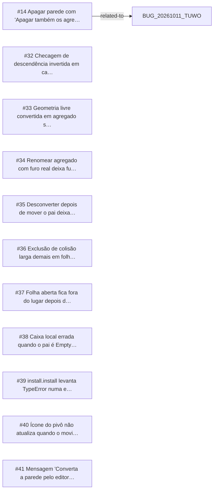

<!-- GENERATED, DO NOT EDIT: regenerado por /reversa-debugger-graph em 2026-11-24T06:45:20+00:00 a partir de 11 bugs -->

# Grafo · aggregates

## Clusters

- `caffmob_draw/aggregates/convert.py`: 2 bugs (BUG-20261011-ZKQ7, BUG-20261011-NQ2L)
- `caffmob_draw/aggregates/leaf.py`: 2 bugs (BUG-20261011-I7QE, BUG-20261011-MQPR)
- `caffmob_draw/aggregates/ops_aggregate.py`: 2 bugs (BUG-20261011-DXOV, BUG-20261011-5DDZ)

Leitura: 2 bugs convergem em `caffmob_draw/aggregates/convert.py`, o maior ponto de convergência do contexto. Nenhum bug aberto neste contexto: o cluster mostra onde as correções se acumularam.

## Impact score

Heurística de triagem (não substitui priority/severity): causados ×3, bloqueados ×2, regressões ×4, relacionados ×1 (no máximo 3 no total), só arestas supported/confirmed.

| # | ID | score |
|---|---|---|
