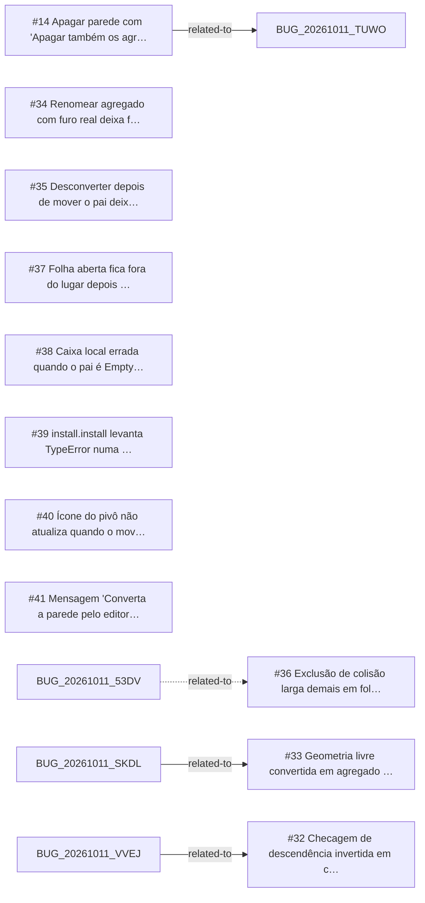

<!-- GENERATED, DO NOT EDIT: regenerado por /reversa-debugger-graph em 2026-10-12T03:59:30+00:00 a partir de 11 bugs -->

# Grafo · aggregates

## Clusters

- `caffmob_draw/aggregates/ops_aggregate.py`: 2 bugs (BUG-20261011-DXOV, BUG-20261011-5DDZ)
- `caffmob_draw/aggregates/convert.py`: 2 bugs (BUG-20261011-ZKQ7, BUG-20261011-NQ2L)
- `caffmob_draw/aggregates/leaf.py`: 2 bugs (BUG-20261011-I7QE, BUG-20261011-MQPR)

Leitura: 2 bugs convergem em `caffmob_draw/aggregates/ops_aggregate.py`, o maior ponto de convergência do contexto; vale corrigi-los numa mesma passada.

## Impact score

Heurística de triagem (não substitui priority/severity): só arestas supported/confirmed contam.

Todas as relações abertas estão como `proposed`: score 0 para todos.
