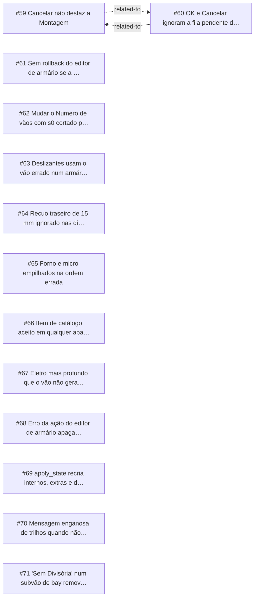

<!-- GENERATED, DO NOT EDIT: regenerado por /reversa-debugger-graph em 2026-10-12T03:01:13+00:00 a partir de 13 bugs -->

# Grafo · cabinet_editor

## Clusters

- `caffmob_draw/cabinet_editor/ops_editor.py`: 4 bugs (BUG-20261011-6JIM, BUG-20261011-N2D4, BUG-20261011-TRMB, BUG-20261011-E33D)
- `caffmob_draw/cabinet_editor/divisions.py`: 3 bugs (BUG-20261011-5R7U, BUG-20261011-HF2J, BUG-20261011-FYXD)
- `caffmob_draw/cabinet_editor/bays.py`: 2 bugs (BUG-20261011-5R7U, BUG-20261011-FYXD)
- `caffmob_draw/cabinet_editor/slides.py`: 2 bugs (BUG-20261011-FHQN, BUG-20261011-FGTR)
- `caffmob_draw/cabinet_editor/catalog.py`: 2 bugs (BUG-20261011-HF2J, BUG-20261011-HR3U)
- `caffmob_draw/cabinet_editor/appliances.py`: 2 bugs (BUG-20261011-HVYM, BUG-20261011-TFC7)
- `caffmob_draw/cabinet_editor/validate.py`: 2 bugs (BUG-20261011-HR3U, BUG-20261011-TFC7)

Leitura: 4 bugs convergem em `caffmob_draw/cabinet_editor/ops_editor.py`, o maior ponto de convergência do contexto; vale corrigi-los numa mesma passada.

## Impact score

Heurística de triagem (não substitui priority/severity): só arestas supported/confirmed contam.

Todas as relações abertas estão como `proposed`: score 0 para todos.
