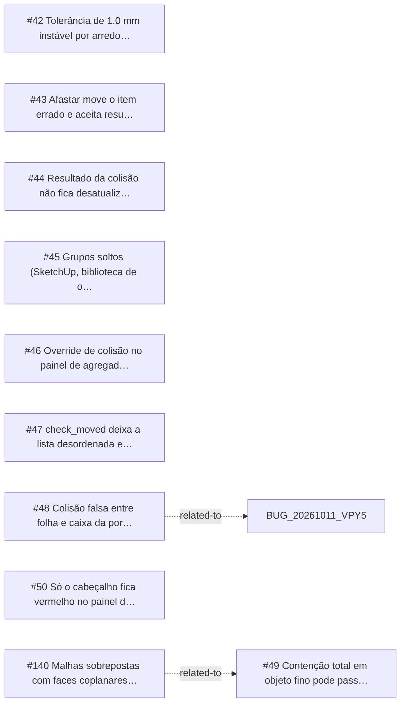

<!-- GENERATED, DO NOT EDIT: regenerado por /reversa-debugger-graph em 2026-11-18T15:34:10+00:00 a partir de 10 bugs -->

# Grafo · collision

## Clusters

- `caffmob_draw/collision/ops_collision.py`: 3 bugs (BUG-20261011-KX3O, BUG-20261011-TIPN, BUG-20261011-7GRY)
- `caffmob_draw/collision/obb.py`: 2 bugs (BUG-20261011-SRPV, BUG-20261011-EWKD)
- `caffmob_draw/collision/panels.py`: 2 bugs (BUG-20261011-JUJZ, BUG-20261011-ZEN6)
- `caffmob_draw/collision/rules.py`: 2 bugs (BUG-20261011-SRPV, BUG-20261011-53DV)
- `caffmob_draw/collision/scan.py`: 2 bugs (BUG-20261011-L5ML, BUG-20261012-PFY2)

Leitura: 3 bugs convergem em `caffmob_draw/collision/ops_collision.py`, o maior ponto de convergência do contexto. Nenhum bug aberto neste contexto: o cluster mostra onde as correções se acumularam.

## Impact score

Heurística de triagem (não substitui priority/severity): causados ×3, bloqueados ×2, regressões ×4, relacionados ×1 (no máximo 3 no total), só arestas supported/confirmed.

| # | ID | score |
|---|---|---|
