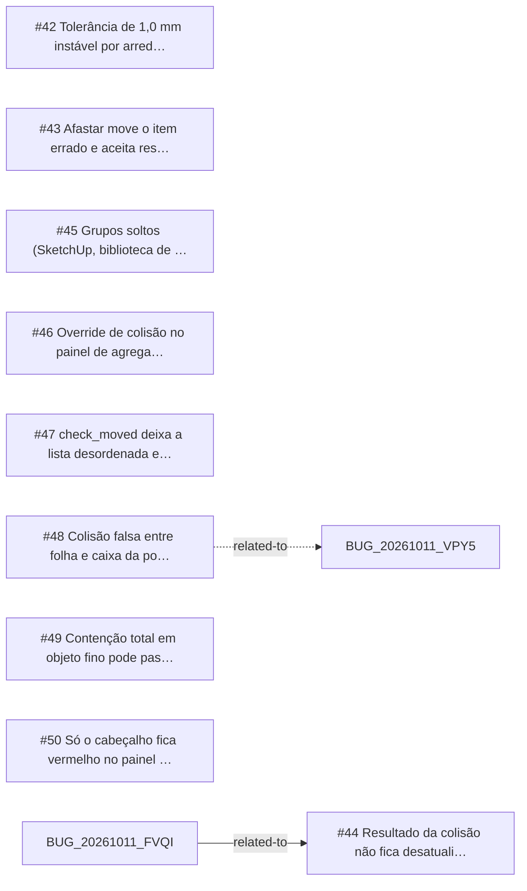

<!-- GENERATED, DO NOT EDIT: regenerado por /reversa-debugger-graph em 2026-10-12T02:39:10+00:00 a partir de 9 bugs -->

# Grafo · collision

## Clusters

- `caffmob_draw/collision/ops_collision.py`: 3 bugs (BUG-20261011-KX3O, BUG-20261011-TIPN, BUG-20261011-7GRY)
- `caffmob_draw/collision/rules.py`: 2 bugs (BUG-20261011-SRPV, BUG-20261011-53DV)
- `caffmob_draw/collision/obb.py`: 2 bugs (BUG-20261011-SRPV, BUG-20261011-EWKD)
- `caffmob_draw/collision/panels.py`: 2 bugs (BUG-20261011-JUJZ, BUG-20261011-ZEN6)

Leitura: 3 bugs convergem em `caffmob_draw/collision/ops_collision.py`, o maior ponto de convergência do contexto; vale corrigi-los numa mesma passada.

## Impact score

Heurística de triagem (não substitui priority/severity): só arestas supported/confirmed contam.

Todas as relações abertas estão como `proposed`: score 0 para todos.
