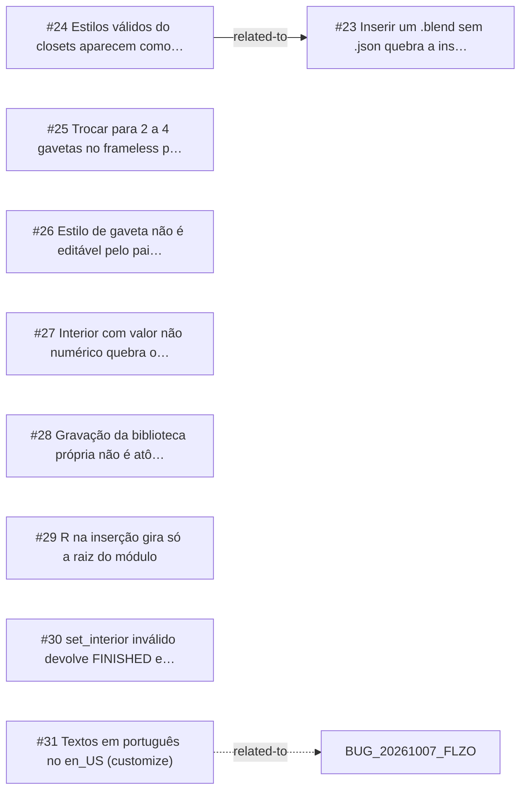

<!-- GENERATED, DO NOT EDIT: regenerado por /reversa-debugger-graph em 2026-11-18T15:34:10+00:00 a partir de 9 bugs -->

# Grafo · customize

## Clusters

- `caffmob_draw/customize/library_io.py`: 3 bugs (BUG-20261011-J2NY, BUG-20261011-MRZC, BUG-20261011-OJBL)
- `caffmob_draw/customize/ops_library.py`: 3 bugs (BUG-20261011-J2NY, BUG-20261011-GL62, BUG-20261011-35HE)
- `caffmob_draw/customize/ops_customize.py`: 2 bugs (BUG-20261011-ODY2, BUG-20261011-35HE)
- `caffmob_draw/customize/panels.py`: 2 bugs (BUG-20261011-XMUG, BUG-20261011-MNX3)
- `caffmob_draw/customize/reapply.py`: 2 bugs (BUG-20261011-UJ5Q, BUG-20261011-MNX3)

Leitura: 3 bugs convergem em `caffmob_draw/customize/library_io.py`, o maior ponto de convergência do contexto. Nenhum bug aberto neste contexto: o cluster mostra onde as correções se acumularam.

## Impact score

Heurística de triagem (não substitui priority/severity): causados ×3, bloqueados ×2, regressões ×4, relacionados ×1 (no máximo 3 no total), só arestas supported/confirmed.

| # | ID | score |
|---|---|---|
| 23 | BUG-20261011-J2NY | 1 |
