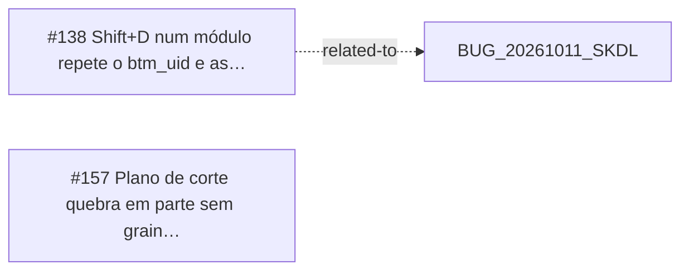

<!-- GENERATED, DO NOT EDIT: regenerado por /reversa-debugger-graph em 2026-11-24T06:45:20+00:00 a partir de 2 bugs -->

# Grafo · cutting

## Clusters

- `caffmob_draw/cutting/part_sources.py`: 2 bugs (BUG-20261012-YUDY, BUG-20261124-3Q9X)

Leitura: 2 bugs convergem em `caffmob_draw/cutting/part_sources.py`, o maior ponto de convergência do contexto. Nenhum bug aberto neste contexto: o cluster mostra onde as correções se acumularam.

## Impact score

Heurística de triagem (não substitui priority/severity): causados ×3, bloqueados ×2, regressões ×4, relacionados ×1 (no máximo 3 no total), só arestas supported/confirmed.

| # | ID | score |
|---|---|---|
