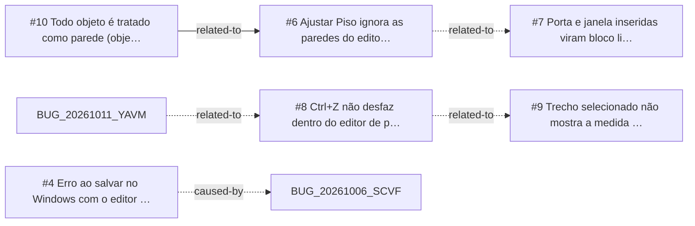

<!-- GENERATED, DO NOT EDIT: regenerado por /reversa-debugger-graph em 2026-10-12T02:46:19+00:00 a partir de 6 bugs -->

# Grafo · editor-de-paredes

## Clusters

- `caffmob_draw/data/properties.py`: 2 bugs (BUG-20261007-A2G7, BUG-20261007-TBY3)
- `caffmob_draw/walls2d/apply.py`: 2 bugs (BUG-20261007-A2G7, BUG-20261007-YIMY)
- `caffmob_draw/walls2d/model.py`: 2 bugs (BUG-20261007-YIMY, BUG-20261007-ZZUK)
- `caffmob_draw/walls2d/ops_editor.py`: 2 bugs (BUG-20261007-ZZUK, BUG-20261007-VQ72)
- `caffmob_draw/walls2d/props.py`: 2 bugs (BUG-20261007-ZZUK, BUG-20261007-VQ72)

Leitura: 2 bugs convergem em `caffmob_draw/data/properties.py`, o maior ponto de convergência do contexto; vale corrigi-los numa mesma passada.

## Impact score

Heurística de triagem (não substitui priority/severity): só arestas supported/confirmed contam.

Todas as relações abertas estão como `proposed`: score 0 para todos.
