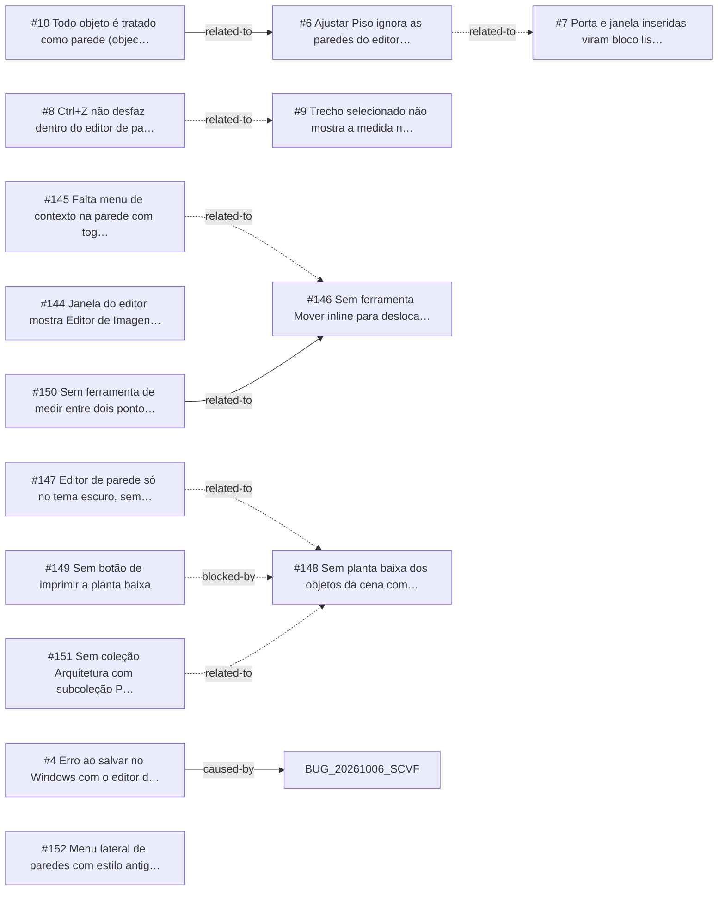

<!-- GENERATED, DO NOT EDIT: regenerado por /reversa-debugger-graph em 2026-11-17T19:42:35+00:00 a partir de 15 bugs -->

# Grafo · editor-de-paredes

## Clusters

- `caffmob_draw/walls2d/ops_editor.py`: 9 bugs (BUG-20261007-ZZUK, BUG-20261007-VQ72, BUG-20261117-AKYJ, BUG-20261117-EELF, BUG-20261117-6OXN, BUG-20261117-JXDJ, BUG-20261117-744U, BUG-20261117-V4I3, BUG-20261117-4MF7)
- `caffmob_draw/walls2d/classico_v2.py`: 6 bugs (BUG-20261117-AKYJ, BUG-20261117-EELF, BUG-20261117-6OXN, BUG-20261117-JXDJ, BUG-20261117-V4I3, BUG-20261117-RP9Q)
- `caffmob_draw/walls2d/props.py`: 6 bugs (BUG-20261007-ZZUK, BUG-20261007-VQ72, BUG-20261117-AKYJ, BUG-20261117-EELF, BUG-20261117-6OXN, BUG-20261117-V4I3)
- `caffmob_draw/walls2d/panels.py`: 5 bugs (BUG-20261007-VQ72, BUG-20261117-AKYJ, BUG-20261117-EELF, BUG-20261117-V4I3, BUG-20261117-RP9Q)
- `caffmob_draw/walls2d/apply.py`: 3 bugs (BUG-20261007-A2G7, BUG-20261007-YIMY, BUG-20261117-4MF7)
- `caffmob_draw/walls2d/model.py`: 3 bugs (BUG-20261007-YIMY, BUG-20261007-ZZUK, BUG-20261117-EELF)
- `caffmob_draw/data/properties.py`: 2 bugs (BUG-20261007-A2G7, BUG-20261007-TBY3)
- `caffmob_draw/operators/layouts.py`: 2 bugs (BUG-20261117-JXDJ, BUG-20261117-744U)
- `caffmob_draw/ui/view3d_sidebar.py`: 2 bugs (BUG-20261117-JXDJ, BUG-20261117-744U)
- `caffmob_draw/walls2d/scene_io.py`: 2 bugs (BUG-20261007-TBY3, BUG-20261117-JXDJ)
- `caffmob_draw/walls2d/window.py`: 2 bugs (BUG-20261007-VQ72, BUG-20261117-6KBC)

Leitura: 9 bugs convergem em `caffmob_draw/walls2d/ops_editor.py`, o maior ponto de convergência do contexto. Dos 5 abertos, 3 apontam para esse arquivo.

## Impact score

Heurística de triagem (não substitui priority/severity): só arestas supported/confirmed contam.

| # | ID | score |
|---|---|---|
| 6 | BUG-20261007-A2G7 | 1 |
| 10 | BUG-20261007-TBY3 | 1 |
| 146 | BUG-20261117-EELF | 1 |
| 150 | BUG-20261117-V4I3 | 1 |
