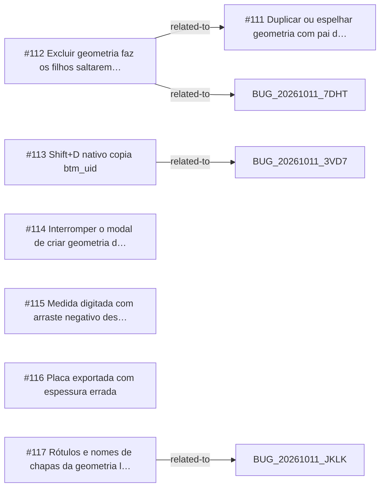

<!-- GENERATED, DO NOT EDIT: regenerado por /reversa-debugger-graph em 2026-11-18T15:34:10+00:00 a partir de 7 bugs -->

# Grafo · geometry_free

## Clusters

- `caffmob_draw/geometry_free/mesh.py`: 2 bugs (BUG-20261011-L6YN, BUG-20261011-DLHX)
- `caffmob_draw/geometry_free/ops_create.py`: 2 bugs (BUG-20261011-TLCT, BUG-20261011-NOAU)
- `caffmob_draw/geometry_free/ops_edit.py`: 2 bugs (BUG-20261011-ELOZ, BUG-20261011-GUHQ)
- `caffmob_draw/geometry_free/props.py`: 2 bugs (BUG-20261011-SKDL, BUG-20261011-DLHX)

Leitura: 2 bugs convergem em `caffmob_draw/geometry_free/mesh.py`, o maior ponto de convergência do contexto. Nenhum bug aberto neste contexto: o cluster mostra onde as correções se acumularam.

## Impact score

Heurística de triagem (não substitui priority/severity): causados ×3, bloqueados ×2, regressões ×4, relacionados ×1 (no máximo 3 no total), só arestas supported/confirmed.

| # | ID | score |
|---|---|---|
| 111 | BUG-20261011-ELOZ | 1 |
