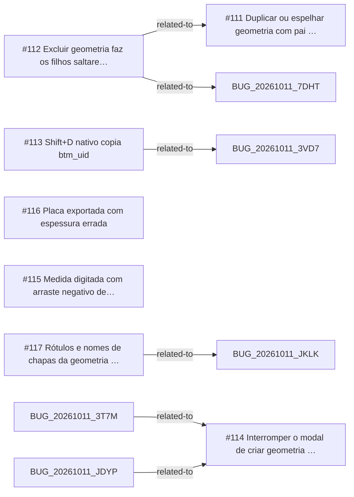

<!-- GENERATED, DO NOT EDIT: regenerado por /reversa-debugger-graph em 2026-10-12T02:21:02+00:00 a partir de 7 bugs -->

# Grafo · geometry_free

## Clusters

- `caffmob_draw/geometry_free/ops_edit.py`: 2 bugs (BUG-20261011-GUHQ, BUG-20261011-ELOZ)
- `caffmob_draw/geometry_free/props.py`: 2 bugs (BUG-20261011-SKDL, BUG-20261011-DLHX)
- `caffmob_draw/geometry_free/mesh.py`: 2 bugs (BUG-20261011-L6YN, BUG-20261011-DLHX)
- `caffmob_draw/geometry_free/ops_create.py`: 2 bugs (BUG-20261011-TLCT, BUG-20261011-NOAU)

Leitura: 2 bugs convergem em `caffmob_draw/geometry_free/ops_edit.py`, o maior ponto de convergência do contexto; vale corrigi-los numa mesma passada.

## Impact score

Heurística de triagem (não substitui priority/severity): só arestas supported/confirmed contam.

Todas as relações abertas estão como `proposed`: score 0 para todos.
