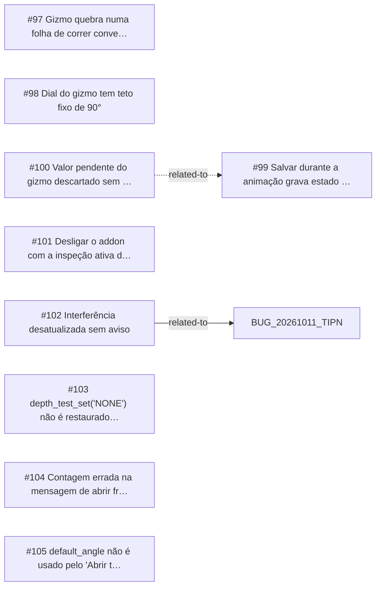

<!-- GENERATED, DO NOT EDIT: regenerado por /reversa-debugger-graph em 2026-10-12T04:13:57+00:00 a partir de 9 bugs -->

# Grafo · inspection

## Clusters

- `caffmob_draw/inspection/gizmo.py`: 3 bugs (BUG-20261011-5EX7, BUG-20261011-GBPG, BUG-20261011-PGMI)
- `caffmob_draw/inspection/fronts.py`: 2 bugs (BUG-20261011-6AX3, BUG-20261011-B54S)

Leitura: 3 bugs convergem em `caffmob_draw/inspection/gizmo.py`, o maior ponto de convergência do contexto; vale corrigi-los numa mesma passada.

## Impact score

Heurística de triagem (não substitui priority/severity): só arestas supported/confirmed contam.

Todas as relações abertas estão como `proposed`: score 0 para todos.
