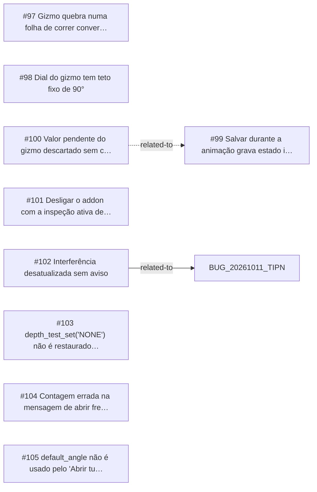

<!-- GENERATED, DO NOT EDIT: regenerado por /reversa-debugger-graph em 2026-11-18T15:34:10+00:00 a partir de 9 bugs -->

# Grafo · inspection

## Clusters

- `caffmob_draw/inspection/gizmo.py`: 3 bugs (BUG-20261011-5EX7, BUG-20261011-GBPG, BUG-20261011-PGMI)
- `caffmob_draw/inspection/fronts.py`: 2 bugs (BUG-20261011-6AX3, BUG-20261011-B54S)

Leitura: 3 bugs convergem em `caffmob_draw/inspection/gizmo.py`, o maior ponto de convergência do contexto. Nenhum bug aberto neste contexto: o cluster mostra onde as correções se acumularam.

## Impact score

Heurística de triagem (não substitui priority/severity): causados ×3, bloqueados ×2, regressões ×4, relacionados ×1 (no máximo 3 no total), só arestas supported/confirmed.

| # | ID | score |
|---|---|---|
