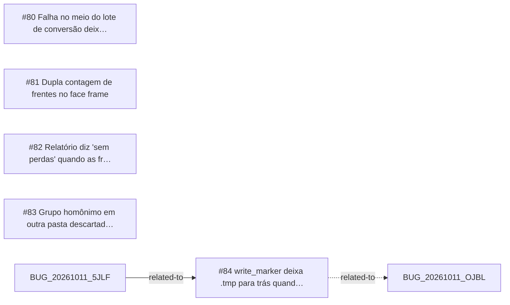

<!-- GENERATED, DO NOT EDIT: regenerado por /reversa-debugger-graph em 2026-10-12T03:56:34+00:00 a partir de 5 bugs -->

# Grafo · legacy

## Clusters

- `caffmob_draw/legacy/convert.py`: 2 bugs (BUG-20261011-5NLX, BUG-20261011-HUWF)
- `caffmob_draw/legacy/convert_core.py`: 2 bugs (BUG-20261011-NTM3, BUG-20261011-HUWF)

Leitura: 2 bugs convergem em `caffmob_draw/legacy/convert.py`, o maior ponto de convergência do contexto; vale corrigi-los numa mesma passada.

## Impact score

Heurística de triagem (não substitui priority/severity): só arestas supported/confirmed contam.

Todas as relações abertas estão como `proposed`: score 0 para todos.
