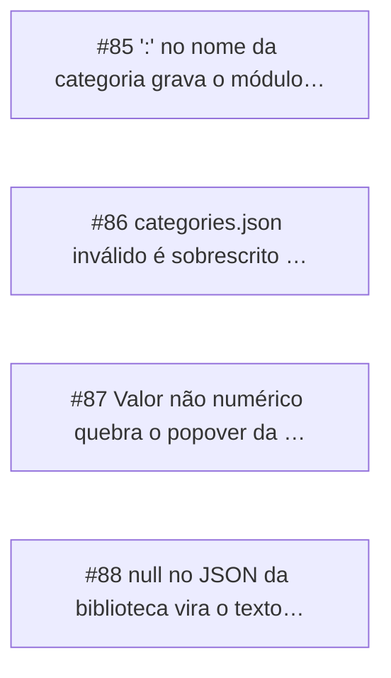

<!-- GENERATED, DO NOT EDIT: regenerado por /reversa-debugger-graph em 2026-10-12T04:02:39+00:00 a partir de 4 bugs -->

# Grafo · library_panel

## Clusters

- `caffmob_draw/library_panel/categories_core.py`: 2 bugs (BUG-20261011-3UWR, BUG-20261011-NCPI)
- `caffmob_draw/library_panel/models_core.py`: 2 bugs (BUG-20261011-2HDG, BUG-20261011-NCPI)

Leitura: 2 bugs convergem em `caffmob_draw/library_panel/categories_core.py`, o maior ponto de convergência do contexto; vale corrigi-los numa mesma passada.

## Impact score

Heurística de triagem (não substitui priority/severity): só arestas supported/confirmed contam.

Todas as relações abertas estão como `proposed`: score 0 para todos.
