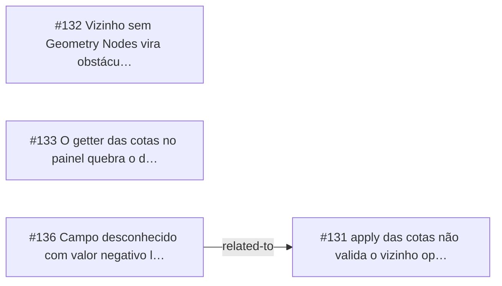

<!-- GENERATED, DO NOT EDIT: regenerado por /reversa-debugger-graph em 2026-10-12T02:39:10+00:00 a partir de 4 bugs -->

# Grafo · measure

## Clusters

- `caffmob_draw/measure/scene_cotas.py`: 2 bugs (BUG-20261011-3W52, BUG-20261011-NBKB)

Leitura: 2 bugs convergem em `caffmob_draw/measure/scene_cotas.py`, o maior ponto de convergência do contexto; vale corrigi-los numa mesma passada.

## Impact score

Heurística de triagem (não substitui priority/severity): só arestas supported/confirmed contam.

Todas as relações abertas estão como `proposed`: score 0 para todos.
