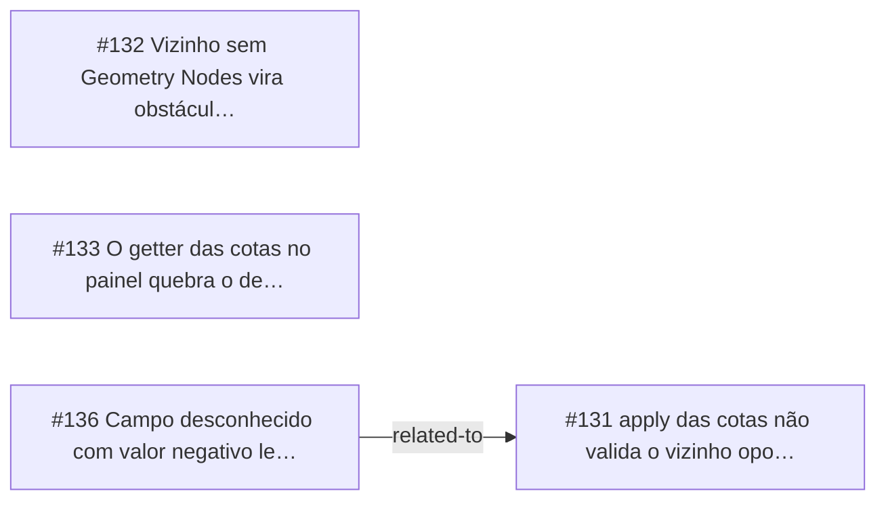

<!-- GENERATED, DO NOT EDIT: regenerado por /reversa-debugger-graph em 2026-11-24T06:45:20+00:00 a partir de 4 bugs -->

# Grafo · measure

## Clusters

- `caffmob_draw/measure/scene_cotas.py`: 2 bugs (BUG-20261011-3W52, BUG-20261011-NBKB)

Leitura: 2 bugs convergem em `caffmob_draw/measure/scene_cotas.py`, o maior ponto de convergência do contexto. Nenhum bug aberto neste contexto: o cluster mostra onde as correções se acumularam.

## Impact score

Heurística de triagem (não substitui priority/severity): causados ×3, bloqueados ×2, regressões ×4, relacionados ×1 (no máximo 3 no total), só arestas supported/confirmed.

| # | ID | score |
|---|---|---|
| 131 | BUG-20261011-3W52 | 1 |
