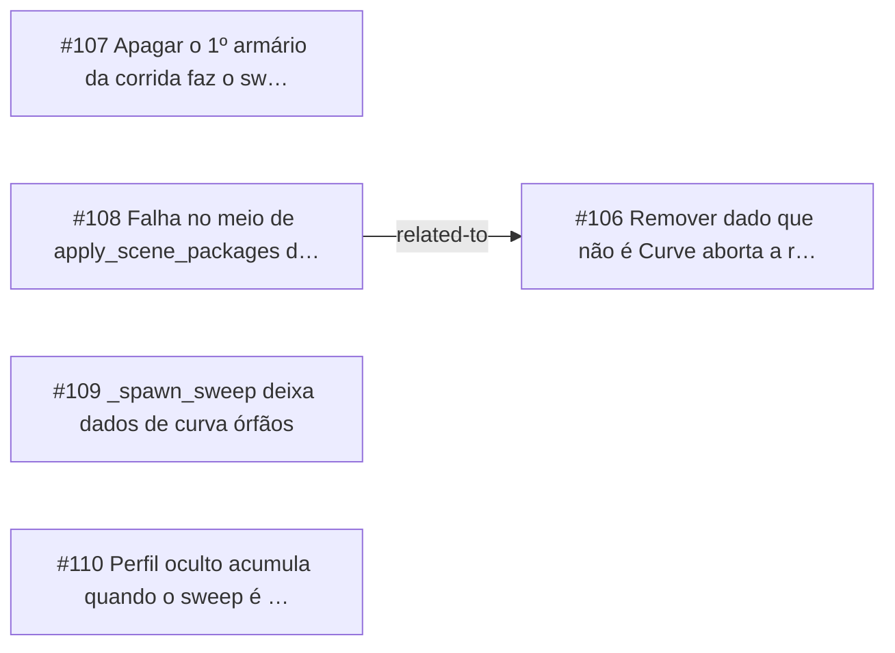

<!-- GENERATED, DO NOT EDIT: regenerado por /reversa-debugger-graph em 2026-10-12T03:56:34+00:00 a partir de 5 bugs -->

# Grafo · molding

## Clusters

- `caffmob_draw/molding/ops.py`: 5 bugs (BUG-20261011-VHMP, BUG-20261011-XP5E, BUG-20261011-QT2G, BUG-20261011-MWN5, BUG-20261011-ARCH)

Leitura: 5 bugs convergem em `caffmob_draw/molding/ops.py`, o maior ponto de convergência do contexto; vale corrigi-los numa mesma passada.

## Impact score

Heurística de triagem (não substitui priority/severity): só arestas supported/confirmed contam.

Todas as relações abertas estão como `proposed`: score 0 para todos.
