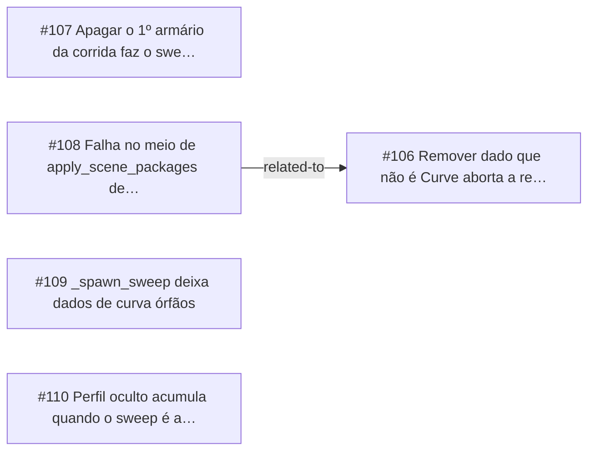

<!-- GENERATED, DO NOT EDIT: regenerado por /reversa-debugger-graph em 2026-11-24T06:45:20+00:00 a partir de 5 bugs -->

# Grafo · molding

## Clusters

- `caffmob_draw/molding/ops.py`: 5 bugs (BUG-20261011-VHMP, BUG-20261011-XP5E, BUG-20261011-QT2G, BUG-20261011-MWN5, BUG-20261011-ARCH)

Leitura: 5 bugs convergem em `caffmob_draw/molding/ops.py`, o maior ponto de convergência do contexto. Nenhum bug aberto neste contexto: o cluster mostra onde as correções se acumularam.

## Impact score

Heurística de triagem (não substitui priority/severity): causados ×3, bloqueados ×2, regressões ×4, relacionados ×1 (no máximo 3 no total), só arestas supported/confirmed.

| # | ID | score |
|---|---|---|
| 106 | BUG-20261011-VHMP | 1 |
