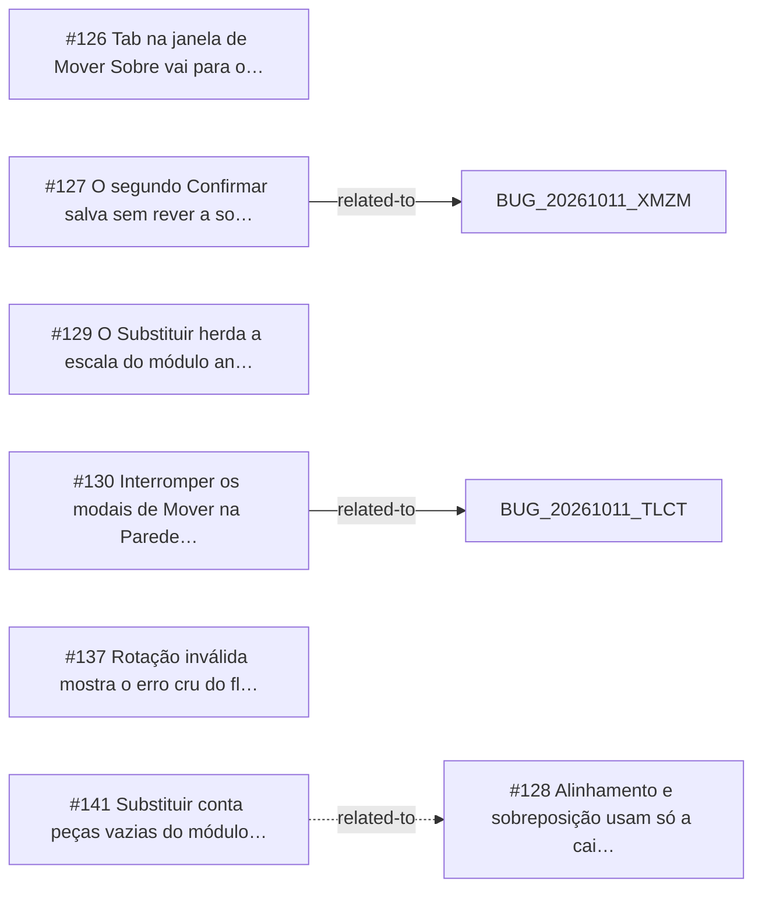

<!-- GENERATED, DO NOT EDIT: regenerado por /reversa-debugger-graph em 2026-11-24T06:45:20+00:00 a partir de 7 bugs -->

# Grafo · move_over

## Clusters

- `caffmob_draw/move_over/ops_dialog.py`: 3 bugs (BUG-20261011-CKVJ, BUG-20261011-JMDR, BUG-20261011-CNTL)
- `caffmob_draw/move_over/ops_substitute.py`: 2 bugs (BUG-20261011-X5OS, BUG-20261012-DWPO)
- `caffmob_draw/move_over/scene.py`: 2 bugs (BUG-20261011-LWF6, BUG-20261012-DWPO)

Leitura: 3 bugs convergem em `caffmob_draw/move_over/ops_dialog.py`, o maior ponto de convergência do contexto. Nenhum bug aberto neste contexto: o cluster mostra onde as correções se acumularam.

## Impact score

Heurística de triagem (não substitui priority/severity): causados ×3, bloqueados ×2, regressões ×4, relacionados ×1 (no máximo 3 no total), só arestas supported/confirmed.

| # | ID | score |
|---|---|---|
