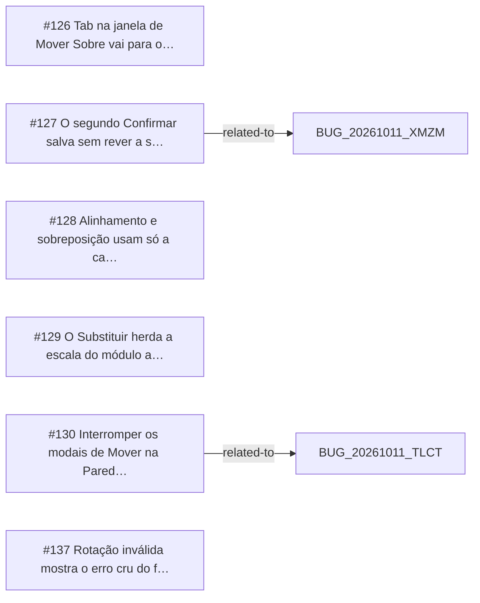

<!-- GENERATED, DO NOT EDIT: regenerado por /reversa-debugger-graph em 2026-10-12T02:16:58+00:00 a partir de 6 bugs -->

# Grafo · move_over

## Clusters

- `caffmob_draw/move_over/ops_dialog.py`: 3 bugs (BUG-20261011-CKVJ, BUG-20261011-JMDR, BUG-20261011-CNTL)

Leitura: 3 bugs convergem em `caffmob_draw/move_over/ops_dialog.py`, o maior ponto de convergência do contexto; vale corrigi-los numa mesma passada.

## Impact score

Heurística de triagem (não substitui priority/severity): só arestas supported/confirmed contam.

Todas as relações abertas estão como `proposed`: score 0 para todos.
