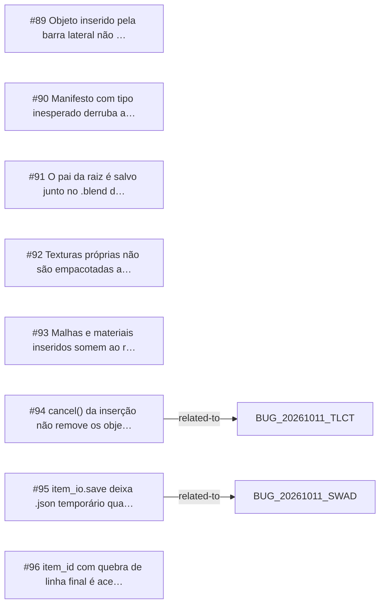

<!-- GENERATED, DO NOT EDIT: regenerado por /reversa-debugger-graph em 2026-10-12T02:01:54+00:00 a partir de 8 bugs -->

# Grafo · object_library

## Clusters

- `caffmob_draw/object_library/item_io.py`: 4 bugs (BUG-20261011-QZSO, BUG-20261011-JKZJ, BUG-20261011-QP4R, BUG-20261011-5JLF)
- `caffmob_draw/object_library/ops.py`: 3 bugs (BUG-20261011-W2DP, BUG-20261011-QP4R, BUG-20261011-JDYP)

Leitura: 4 bugs convergem em `caffmob_draw/object_library/item_io.py`, o maior ponto de convergência do contexto; vale corrigi-los numa mesma passada.

## Impact score

Heurística de triagem (não substitui priority/severity): só arestas supported/confirmed contam.

Todas as relações abertas estão como `proposed`: score 0 para todos.
