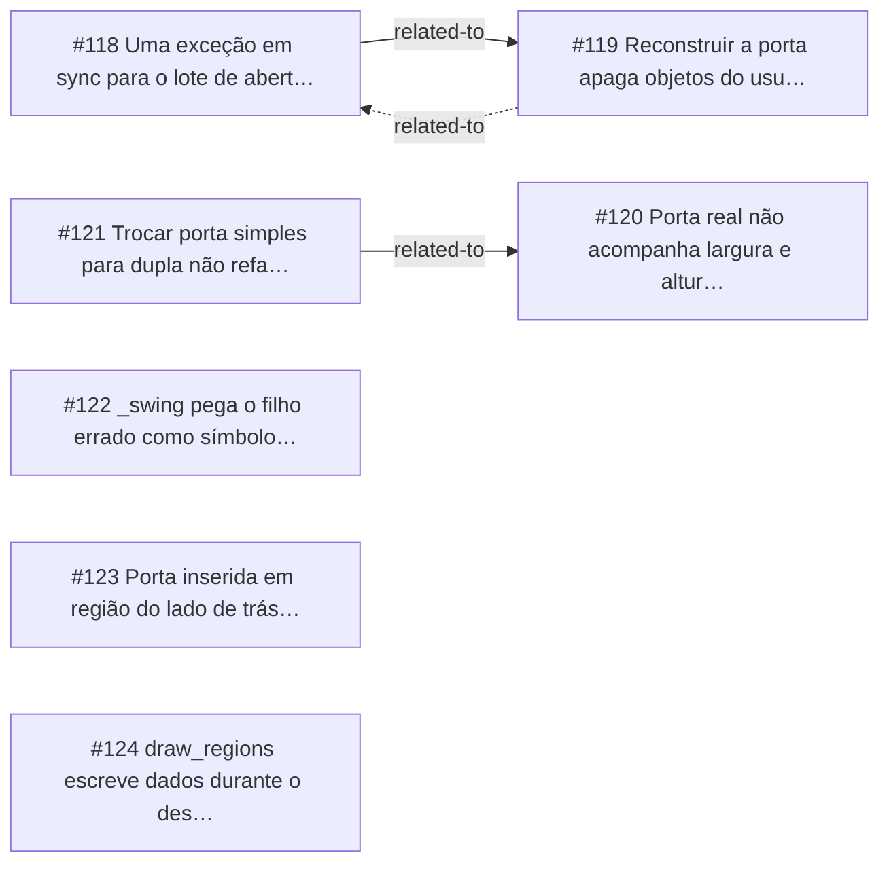

<!-- GENERATED, DO NOT EDIT: regenerado por /reversa-debugger-graph em 2026-11-18T15:34:10+00:00 a partir de 7 bugs -->

# Grafo · openings

## Clusters

- `caffmob_draw/openings/sync.py`: 5 bugs (BUG-20261011-A2Z4, BUG-20261011-MMVI, BUG-20261011-IDPP, BUG-20261011-UV6S, BUG-20261011-SX4T)
- `caffmob_draw/openings/region.py`: 2 bugs (BUG-20261011-7SNG, BUG-20261011-D3GC)

Leitura: 5 bugs convergem em `caffmob_draw/openings/sync.py`, o maior ponto de convergência do contexto. Nenhum bug aberto neste contexto: o cluster mostra onde as correções se acumularam.

## Impact score

Heurística de triagem (não substitui priority/severity): causados ×3, bloqueados ×2, regressões ×4, relacionados ×1 (no máximo 3 no total), só arestas supported/confirmed.

| # | ID | score |
|---|---|---|
| 120 | BUG-20261011-IDPP | 1 |
| 119 | BUG-20261011-MMVI | 1 |
