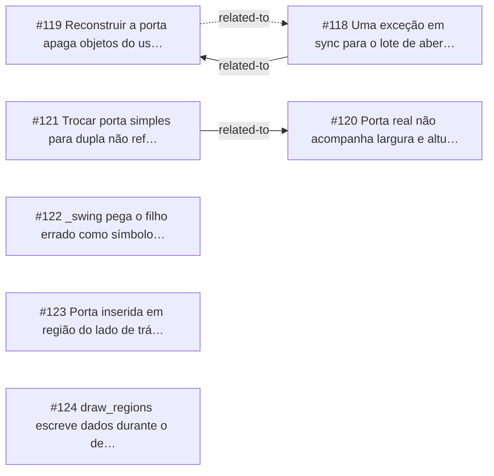

<!-- GENERATED, DO NOT EDIT: regenerado por /reversa-debugger-graph em 2026-10-12T04:02:52+00:00 a partir de 7 bugs -->

# Grafo · openings

## Clusters

- `caffmob_draw/openings/sync.py`: 5 bugs (BUG-20261011-MMVI, BUG-20261011-A2Z4, BUG-20261011-IDPP, BUG-20261011-UV6S, BUG-20261011-SX4T)
- `caffmob_draw/openings/region.py`: 2 bugs (BUG-20261011-7SNG, BUG-20261011-D3GC)

Leitura: 5 bugs convergem em `caffmob_draw/openings/sync.py`, o maior ponto de convergência do contexto; vale corrigi-los numa mesma passada.

## Impact score

Heurística de triagem (não substitui priority/severity): só arestas supported/confirmed contam.

Todas as relações abertas estão como `proposed`: score 0 para todos.
