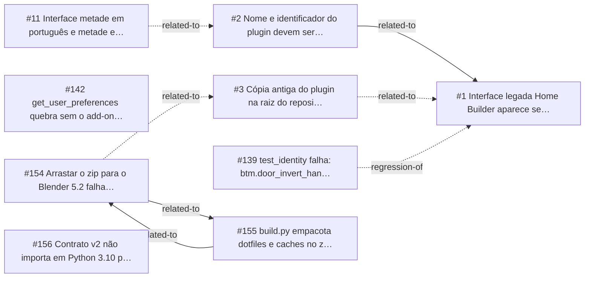

<!-- GENERATED, DO NOT EDIT: regenerado por /reversa-debugger-graph em 2026-11-24T06:45:20+00:00 a partir de 9 bugs -->

# Grafo · plugin-caffmob-draw

## Clusters

- `build.py`: 3 bugs (BUG-20261006-QAVK, BUG-20261006-SCVF, BUG-20261123-RW3G)
- `blendertomob/__init__.py`: 2 bugs (BUG-20261006-NO4Q, BUG-20261006-QAVK)

Leitura: 3 bugs convergem em `build.py`, o maior ponto de convergência do contexto. Dos 1 abertos, 0 apontam para esse arquivo.

## Impact score

Heurística de triagem (não substitui priority/severity): causados ×3, bloqueados ×2, regressões ×4, relacionados ×1 (no máximo 3 no total), só arestas supported/confirmed.

| # | ID | score |
|---|---|---|
| 1 | BUG-20261006-NO4Q | 1 |
| 154 | BUG-20261123-56YQ | 1 |
| 155 | BUG-20261123-RW3G | 1 |
