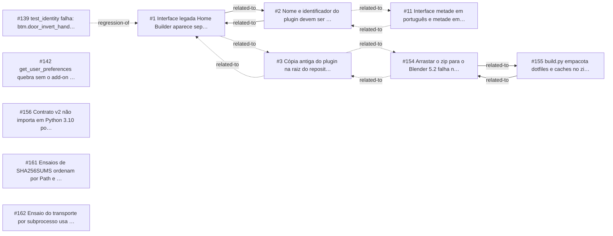

<!-- GENERATED, DO NOT EDIT: regenerado por /reversa-debugger-graph em 2026-11-24T16:57:54+00:00 a partir de 11 bugs -->

# Grafo · plugin-caffmob-draw

## Clusters

- `build.py`: 3 bugs (BUG-20261006-QAVK, BUG-20261006-SCVF, BUG-20261123-RW3G)
- `blendertomob/__init__.py`: 2 bugs (BUG-20261006-NO4Q, BUG-20261006-QAVK)

## Impact score

Heurística de triagem (não substitui priority/severity): causados ×3, bloqueados ×2, regressões ×4, relacionados ×1 (no máximo 3 no total), só arestas supported/confirmed.

| # | ID | score |
|---|---|---|
| 1 | BUG-20261006-NO4Q | 1 |
| 2 | BUG-20261006-QAVK | 1 |
| 154 | BUG-20261123-56YQ | 1 |
| 155 | BUG-20261123-RW3G | 1 |
| 3 | BUG-20261006-SCVF | 0 |
| 11 | BUG-20261007-FLZO | 0 |
| 139 | BUG-20261012-RCOU | 0 |
| 142 | BUG-20261012-WBKI | 0 |
| 156 | BUG-20261124-7K2M | 0 |
| 161 | BUG-20261124-7H3K | 0 |
