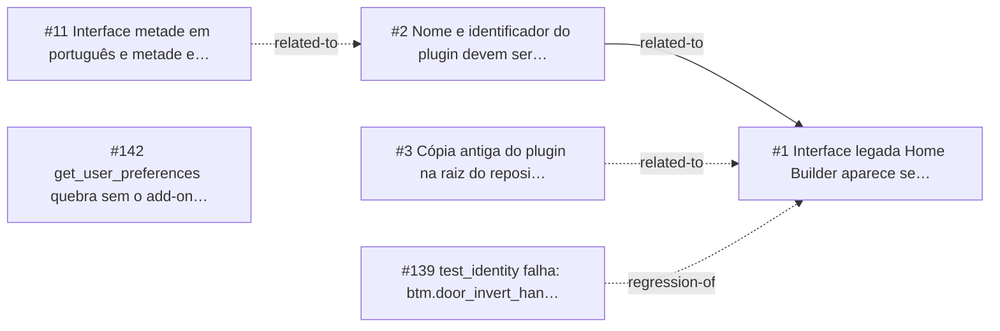

<!-- GENERATED, DO NOT EDIT: regenerado por /reversa-debugger-graph em 2026-11-18T15:34:10+00:00 a partir de 6 bugs -->

# Grafo · plugin-caffmob-draw

## Clusters

- `blendertomob/__init__.py`: 2 bugs (BUG-20261006-NO4Q, BUG-20261006-QAVK)
- `build.py`: 2 bugs (BUG-20261006-QAVK, BUG-20261006-SCVF)

Leitura: 2 bugs convergem em `blendertomob/__init__.py`, o maior ponto de convergência do contexto. Nenhum bug aberto neste contexto: o cluster mostra onde as correções se acumularam.

## Impact score

Heurística de triagem (não substitui priority/severity): causados ×3, bloqueados ×2, regressões ×4, relacionados ×1 (no máximo 3 no total), só arestas supported/confirmed.

| # | ID | score |
|---|---|---|
| 1 | BUG-20261006-NO4Q | 1 |
