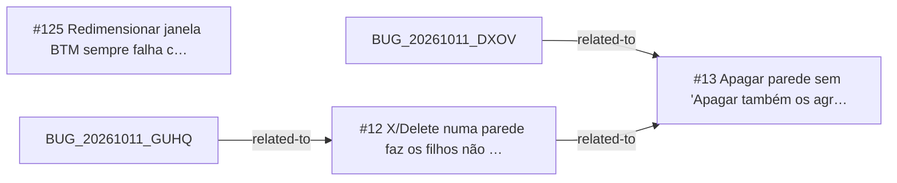

<!-- GENERATED, DO NOT EDIT: regenerado por /reversa-debugger-graph em 2026-10-12T02:54:38+00:00 a partir de 3 bugs -->

# Grafo · selection

## Clusters

- `caffmob_draw/selection/component.py`: 2 bugs (BUG-20261011-7DHT, BUG-20261011-TUWO)
- `caffmob_draw/aggregates/ops_aggregate.py`: 2 bugs (BUG-20261011-7DHT, BUG-20261011-TUWO)

Leitura: 2 bugs convergem em `caffmob_draw/selection/component.py`, o maior ponto de convergência do contexto; vale corrigi-los numa mesma passada.

## Impact score

Heurística de triagem (não substitui priority/severity): só arestas supported/confirmed contam.

Todas as relações abertas estão como `proposed`: score 0 para todos.
