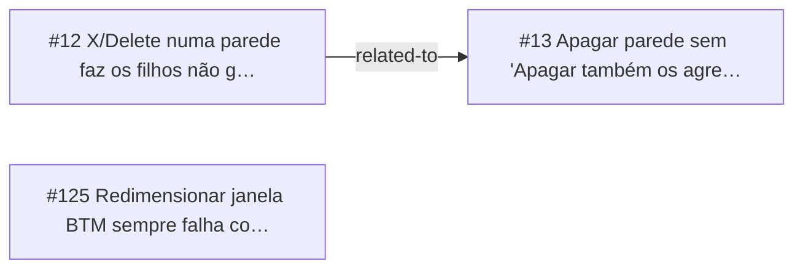

<!-- GENERATED, DO NOT EDIT: regenerado por /reversa-debugger-graph em 2026-11-18T15:34:10+00:00 a partir de 3 bugs -->

# Grafo · selection

## Clusters

- `caffmob_draw/aggregates/ops_aggregate.py`: 2 bugs (BUG-20261011-7DHT, BUG-20261011-TUWO)
- `caffmob_draw/selection/component.py`: 2 bugs (BUG-20261011-7DHT, BUG-20261011-TUWO)

Leitura: 2 bugs convergem em `caffmob_draw/aggregates/ops_aggregate.py`, o maior ponto de convergência do contexto. Nenhum bug aberto neste contexto: o cluster mostra onde as correções se acumularam.

## Impact score

Heurística de triagem (não substitui priority/severity): causados ×3, bloqueados ×2, regressões ×4, relacionados ×1 (no máximo 3 no total), só arestas supported/confirmed.

| # | ID | score |
|---|---|---|
| 13 | BUG-20261011-TUWO | 1 |
