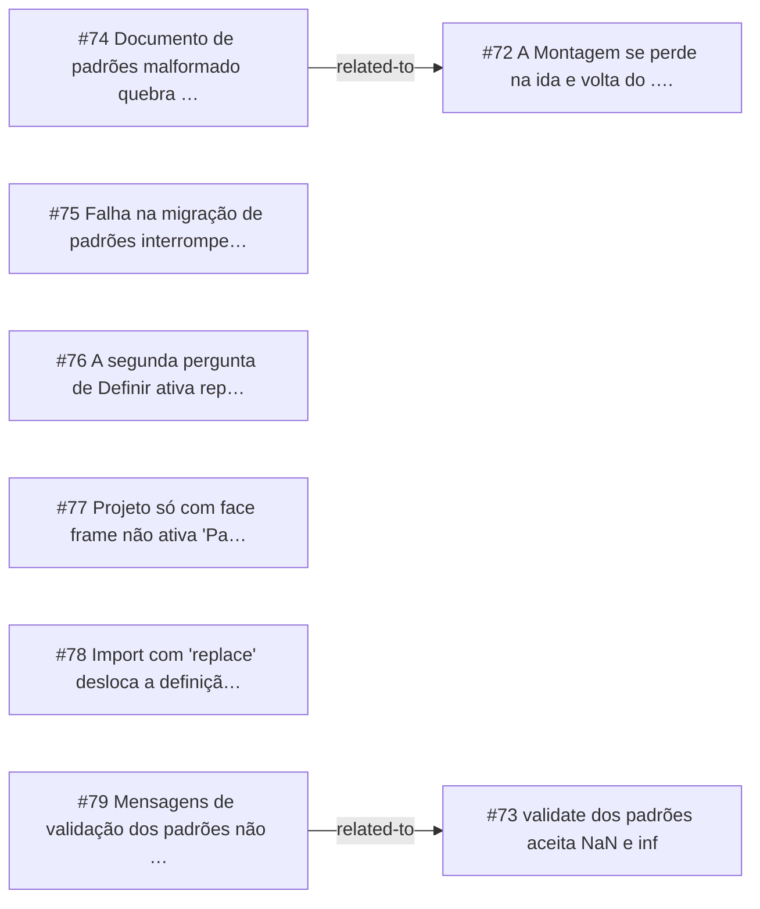

<!-- GENERATED, DO NOT EDIT: regenerado por /reversa-debugger-graph em 2026-10-12T03:01:13+00:00 a partir de 8 bugs -->

# Grafo · standards

## Clusters

- `caffmob_draw/standards/io_json.py`: 3 bugs (BUG-20261011-KVDM, BUG-20261011-3HN6, BUG-20261011-ZATR)
- `caffmob_draw/standards/model.py`: 3 bugs (BUG-20261011-KVDM, BUG-20261011-ZK42, BUG-20261011-EKM7)
- `caffmob_draw/operators/ops_standards.py`: 2 bugs (BUG-20261011-3HN6, BUG-20261011-QO2H)
- `caffmob_draw/standards/migration.py`: 2 bugs (BUG-20261011-MTPU, BUG-20261011-64UD)

Leitura: 3 bugs convergem em `caffmob_draw/standards/io_json.py`, o maior ponto de convergência do contexto; vale corrigi-los numa mesma passada.

## Impact score

Heurística de triagem (não substitui priority/severity): só arestas supported/confirmed contam.

Todas as relações abertas estão como `proposed`: score 0 para todos.
