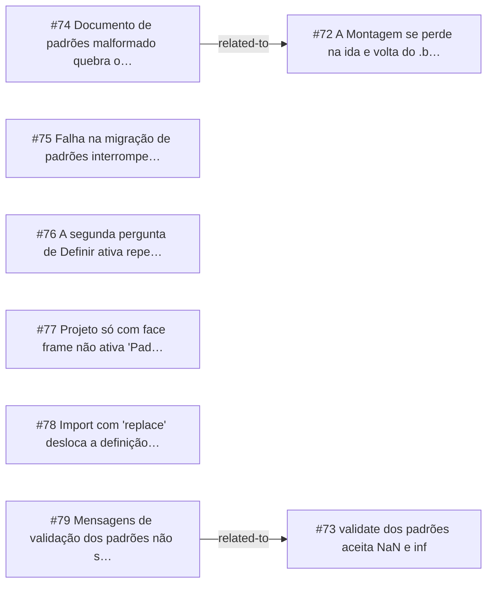

<!-- GENERATED, DO NOT EDIT: regenerado por /reversa-debugger-graph em 2026-11-24T06:45:20+00:00 a partir de 8 bugs -->

# Grafo · standards

## Clusters

- `caffmob_draw/standards/io_json.py`: 3 bugs (BUG-20261011-KVDM, BUG-20261011-3HN6, BUG-20261011-ZATR)
- `caffmob_draw/standards/model.py`: 3 bugs (BUG-20261011-KVDM, BUG-20261011-ZK42, BUG-20261011-EKM7)
- `caffmob_draw/operators/ops_standards.py`: 2 bugs (BUG-20261011-3HN6, BUG-20261011-QO2H)
- `caffmob_draw/standards/migration.py`: 2 bugs (BUG-20261011-MTPU, BUG-20261011-64UD)

Leitura: 3 bugs convergem em `caffmob_draw/standards/io_json.py`, o maior ponto de convergência do contexto. Nenhum bug aberto neste contexto: o cluster mostra onde as correções se acumularam.

## Impact score

Heurística de triagem (não substitui priority/severity): causados ×3, bloqueados ×2, regressões ×4, relacionados ×1 (no máximo 3 no total), só arestas supported/confirmed.

| # | ID | score |
|---|---|---|
| 72 | BUG-20261011-KVDM | 1 |
| 73 | BUG-20261011-ZK42 | 1 |
