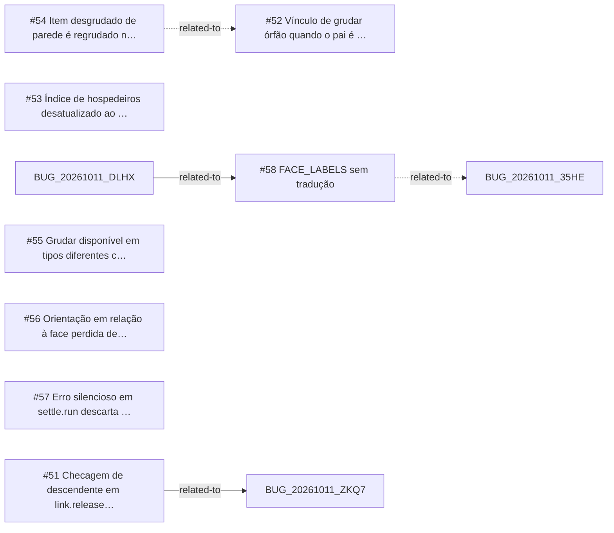

<!-- GENERATED, DO NOT EDIT: regenerado por /reversa-debugger-graph em 2026-10-12T02:13:03+00:00 a partir de 8 bugs -->

# Grafo · stick

## Clusters

- `caffmob_draw/stick/link.py`: 4 bugs (BUG-20261011-VVEJ, BUG-20261011-XPD2, BUG-20261011-XF4S, BUG-20261011-73SM)
- `caffmob_draw/stick/settle.py`: 2 bugs (BUG-20261011-73SM, BUG-20261011-TNY3)

Leitura: 4 bugs convergem em `caffmob_draw/stick/link.py`, o maior ponto de convergência do contexto; vale corrigi-los numa mesma passada.

## Impact score

Heurística de triagem (não substitui priority/severity): só arestas supported/confirmed contam.

Todas as relações abertas estão como `proposed`: score 0 para todos.
