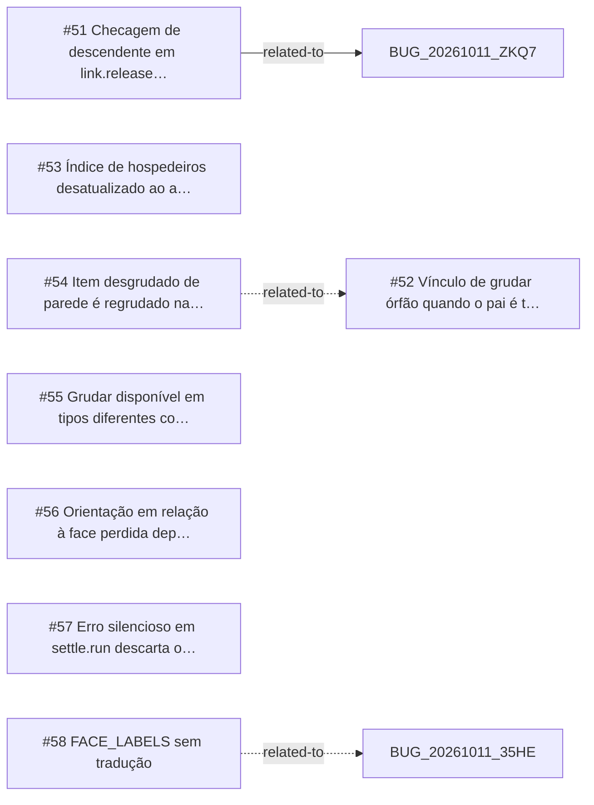

<!-- GENERATED, DO NOT EDIT: regenerado por /reversa-debugger-graph em 2026-11-18T15:34:10+00:00 a partir de 8 bugs -->

# Grafo · stick

## Clusters

- `caffmob_draw/stick/link.py`: 4 bugs (BUG-20261011-VVEJ, BUG-20261011-XPD2, BUG-20261011-XF4S, BUG-20261011-73SM)
- `caffmob_draw/stick/settle.py`: 2 bugs (BUG-20261011-73SM, BUG-20261011-TNY3)

Leitura: 4 bugs convergem em `caffmob_draw/stick/link.py`, o maior ponto de convergência do contexto. Nenhum bug aberto neste contexto: o cluster mostra onde as correções se acumularam.

## Impact score

Heurística de triagem (não substitui priority/severity): causados ×3, bloqueados ×2, regressões ×4, relacionados ×1 (no máximo 3 no total), só arestas supported/confirmed.

| # | ID | score |
|---|---|---|
