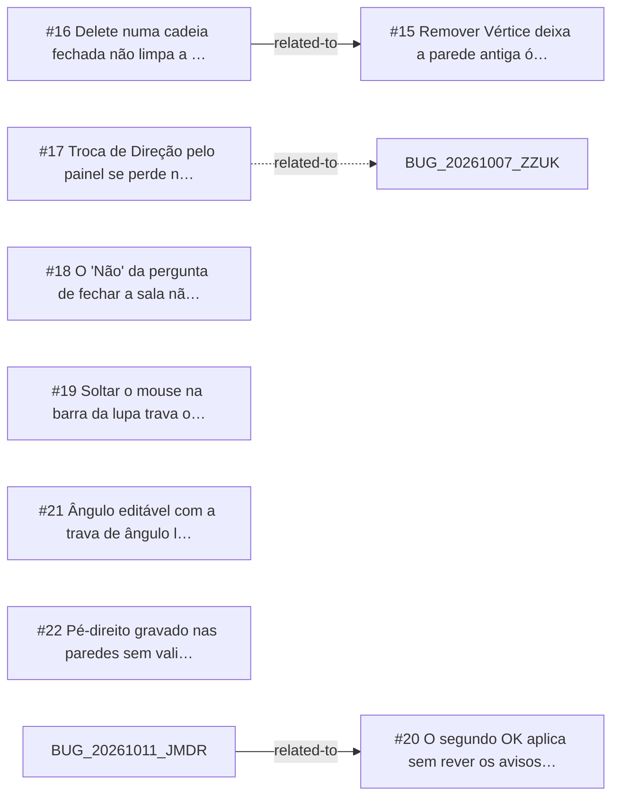

<!-- GENERATED, DO NOT EDIT: regenerado por /reversa-debugger-graph em 2026-10-12T02:45:55+00:00 a partir de 8 bugs -->

# Grafo · walls2d

## Clusters

- `caffmob_draw/walls2d/ops_editor.py`: 5 bugs (BUG-20261011-TLPN, BUG-20261011-GKUE, BUG-20261011-LT3C, BUG-20261011-624G, BUG-20261011-XMZM)
- `caffmob_draw/walls2d/props.py`: 2 bugs (BUG-20261011-YAVM, BUG-20261011-XMZM)
- `caffmob_draw/walls2d/apply.py`: 2 bugs (BUG-20261011-LT3C, BUG-20261011-Z2BL)

Leitura: 5 bugs convergem em `caffmob_draw/walls2d/ops_editor.py`, o maior ponto de convergência do contexto; vale corrigi-los numa mesma passada.

## Impact score

Heurística de triagem (não substitui priority/severity): só arestas supported/confirmed contam.

Todas as relações abertas estão como `proposed`: score 0 para todos.
