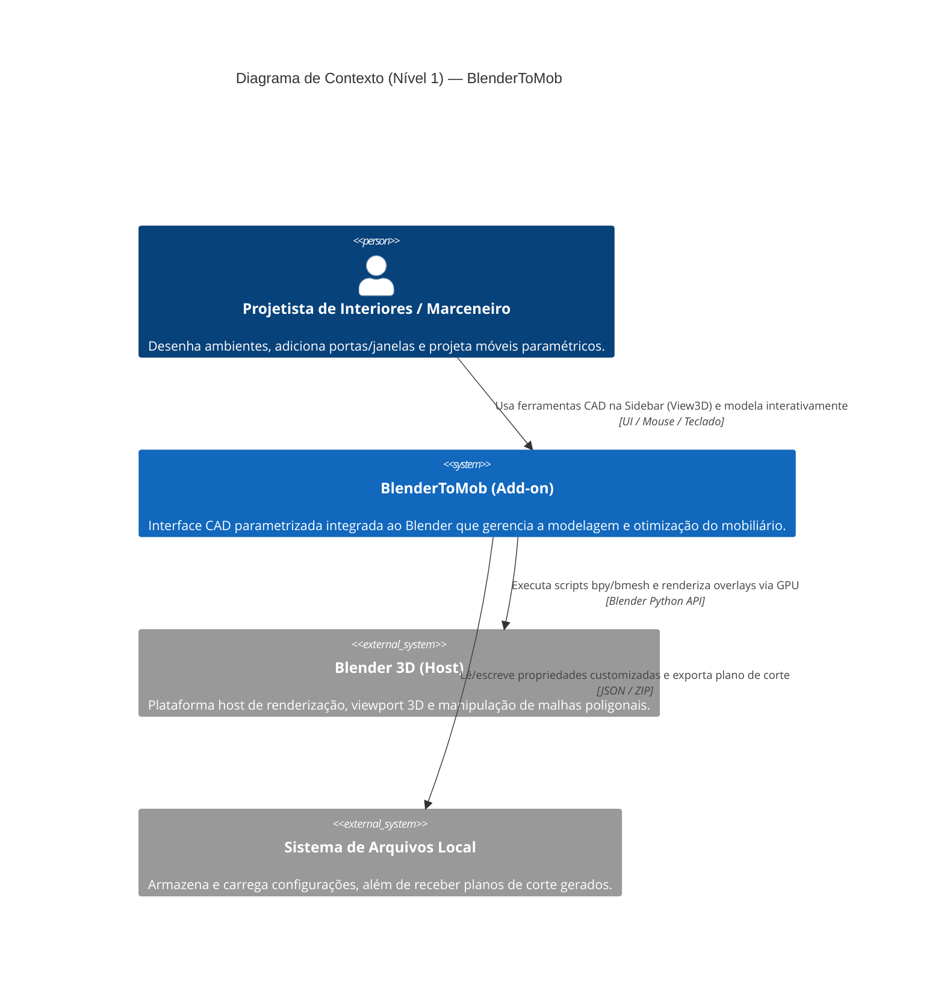
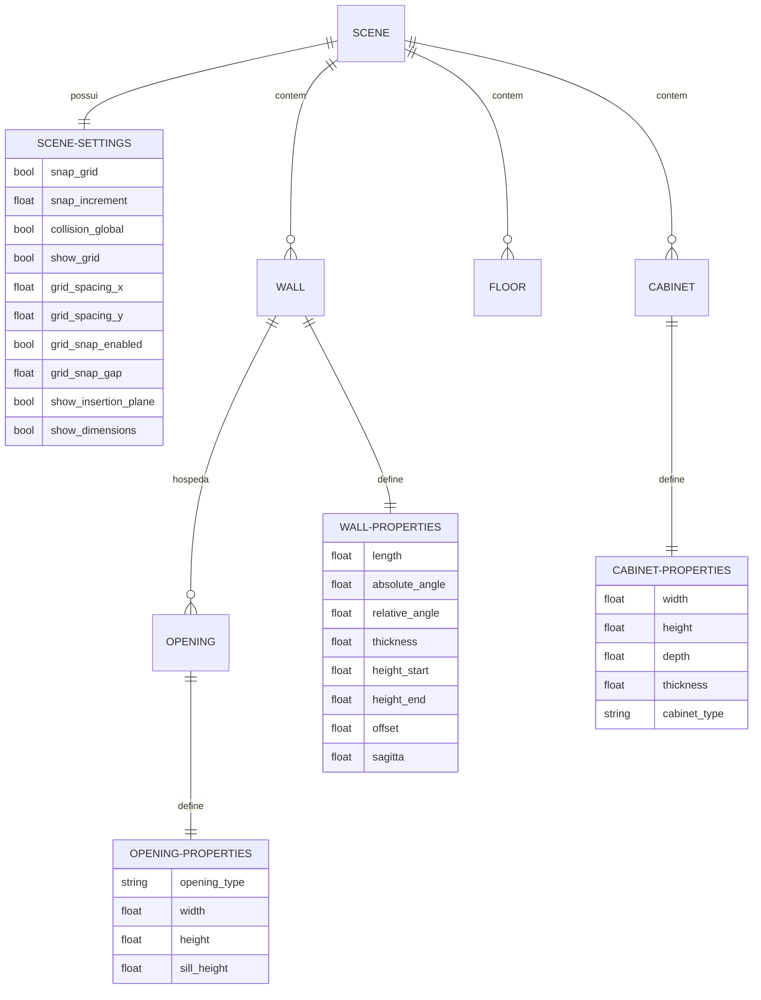

# Visão Geral da Arquitetura — BlenderToMob

Este documento apresenta a especificação arquitetural do sistema **BlenderToMob**, documentada pelo agente **Architect** na fase de Geração.

---

## 1. Visão Geral do Sistema

O **BlenderToMob** é um add-on modular e parametrizado para o Blender 4.2+ (Python 3). Ele segue uma arquitetura orientada a serviços e dados, desacoplada em responsabilidades bem delimitadas. A integração com o Blender se dá por registro dinâmico na API `bpy`.

```
                  ┌────────────────────────────────────────┐
                  │          Blender 3D Viewport           │
                  └──────────────────┬─────────────────────┘
                                     │
                                     ▼
         ┌────────────────────────────────────────────────────────┐
         │                  BlenderToMob UI                       │
         │   (Panels na Sidebar: Environment, Cabinet, Nesting)   │
         └──────────────────────────┬─────────────────────────────┘
                                     │
                                     ▼
         ┌────────────────────────────────────────────────────────┐
         │             Operators (wall, cabinet, openings)        │
         │           (Modal states, snaps, click inputs)          │
         └──────────────────────────┬─────────────────────────────┘
                                     │
                     ┌───────────────┴───────────────┐
                     ▼                               ▼
       ┌───────────────────────────┐   ┌───────────────────────────┐
       │   geometry / mesh_gen     │   │     cutting / nesting     │
       │ (bmesh modeling algorithms)│   │ (bin-packing optimization)│
       └─────────────┬─────────────┘   └───────────────────────────┘
                     │
                     ▼
       ┌───────────────────────────┐
       │     data / properties     │
       │(bpy Custom Property Groups)│
       └───────────────────────────┘
```

---

## 2. Diagrama de Contexto (Mermaid C4)



---

## 3. Modelo de Entidades e Relacionamentos (ERD)

Abaixo está o diagrama ERD simplificado mapeando as entidades paramétricas registradas no Blender e suas relações lógicas de negócio:



---

## 4. Dívidas Técnicas e Lacunas Identificadas

* **Ausência de Testes Automatizados (D-01)**: Mapeamento de 0 arquivos de testes unitários ou de integração na suite atual.
* **Complexidade Cíclica no Raycast da Viewport (D-02)**: O loop modal de aberturas recalcula a distância ponto-segmento 2D contra todas as paredes da cena a cada movimento do mouse (`MOUSEMOVE`), o que pode degradar performance em layouts massivos (com centenas de paredes). Um algoritmo de divisão espacial (ex: Quadtree ou KD-Tree) seria mais escalável a longo prazo.
* **Dificuldade de Desfazer Operações Complexas (D-03)**: A inserção de abertura cria o modificador boolean e o cortador. Embora exista o operador `BTM_OT_RemoveOpening`, a exclusão manual do objeto cortador no Blender sem o operador apropriado deixa o modificador boolean quebrado/órfão na parede.

---

## 5. Escala de Confiança

* **Arquitetura Geral**: 🟢 CONFIRMADO (Mapeado diretamente do registro de módulos em `__init__.py`).
* **Estrutura ERD**: 🟢 CONFIRMADO (Correspondência exata aos PropertyGroups registrados em `data/properties.py`).
* **Dívidas Técnicas**: 🟢 CONFIRMADO (Inferência baseada na leitura do código de loops modais e falta de testes).


## Re-extração 2026-10-10 — arquitetura atual

🟢 **CONFIRMADO** — fotografia da árvore de trabalho, HEAD 83a6863 com alterações locais. Esta seção substitui as premissas antigas de versão, ausência de testes e containers independentes. Pacote: `caffmob_draw/`; manifesto 1.0.1 exige Blender ≥5.2.0. Fonte: `blender_manifest.toml`, `__init__.py`, `build.py` e análises dos 18 módulos.

### Limites e organização

A extensão executa no processo Blender. Painéis, modais, motores geométricos e nesting são componentes Python, não serviços ou processos implantáveis separados. Não foi identificada API HTTP própria, banco relacional, fila ou backend remoto nos fluxos analisados. Sessões de edição/checagem são efêmeras; PropertyGroups/custom properties e hierarquias de objetos persistem no projeto blend. Biblioteca e padrões usam arquivos locais.

| Camada | Componentes | Responsabilidade |
|---|---|---|
| Interação | ui, library_panel, canvas2d | Sidebar, popover, planta GPU e eventos |
| Edição de ambiente | walls2d, openings, geometry_free | Rascunho de paredes, regiões/vãos e objetos livres |
| Mobiliário | cabinet_editor, customize, standards | Chapas/subvãos, personalização, padrão de origem |
| Posicionamento | selection, measure, move_over, stick | Identificar raiz/componente, cotas, referencial e vínculo de face |
| Conteúdo | aggregates, object_library, legacy | Importar, converter e salvar itens com manifestos |
| Verificação | collision, inspection | Corpo e trajetória de frentes; resultados distintos |
| Acabamento legado | molding | Sweeps contínuos face frame/frameless |
| Produção | cutting | Extrair PartRecord da cena e calcular/exportar plano |

### Fluxos entre componentes

1. Padrão ativo → defaults de armário → construção por chapas → editor/divisões → personalização/reflow → extração produtiva.
2. Rascunho 2D → validação/aplicação de paredes → sincronização de aberturas e filhos → geometria/piso.
3. Seleção → raiz/parte → cotas/plano de inserção → mover ou grudar → invalidação de colisão/produção.
4. Importação/conversão → raiz/grupo/agregado → biblioteca local → inserção → acabamento na cena.
5. Front adapter → pose/tween → geometria móvel → interferência por amostras; save guard fecha/reabre conforme preferência.

### Persistência e unidades

Metros na geometria, mm nos padrões e PartRecord. UID de origem é vínculo lógico, não chave estrangeira de banco. Nome de objeto, ponteiro RNA e UID têm papéis diferentes: não são intercambiáveis. Sessões em WindowManager e variáveis de módulo não substituem persistência de domínio. Escritas isoladas por replace não fornecem transação multi-arquivo nem rollback de reconstrução de cena.

### Integrações e distribuição

- 🟢 Blender Python API (bpy/bmesh/gpu/blf/mathutils), callbacks e handlers no thread principal.
- 🟢 Padrões: JSON e XML Promob locais; produção: JSON/CSV e fluxos de documentos existentes. Não há servidor REST a especificar.
- 🟢 Conteúdo: blend/JSON/PNG, importação OBJ e SKP; openskp e dependências distribuídos como wheels CPython 3.13 conforme manifesto. `skp_core` é transformação pura; `skp` lê arquivo via openskp.
- 🟢 Empacotamento: build.py inclui somente caffmob_draw, exclui catalog e caches, verifica ativos de nós/wheels/biblioteca/texturas; fonte espelhada da raiz não integra o ZIP.

### Débitos e limites observados

🟢 Há testes puros e smokes Blender em tests/; a ausência de testes citada na fotografia antiga está obsoleta. Os testes executados nesta escavação constam nos checkpoints por módulo; smokes Blender não foram executados. Molding não tem teste específico localizado.

🔴 Modais com limpeza incompleta no cancelamento externo/desregistro; RNA direto pode ficar inválido. 🔴 Gravação multi-arquivo e reconstruções não têm rollback geral. 🔴 Adaptadores não oferecem capacidades uniformes. 🔴 Amostragem de interferência não equivale a colisão contínua exata. 🔴 Parent/escala precisam testes em geometria livre e percursos de molding. 🟡 Duplicação histórica do código da raiz dificulta orientação; a instrução do projeto define o pacote como autoridade.

Não se recomenda mudança estrutural somente por esse levantamento. As dependências e lacunas registradas devem orientar alterações específicas com testes de contrato.
