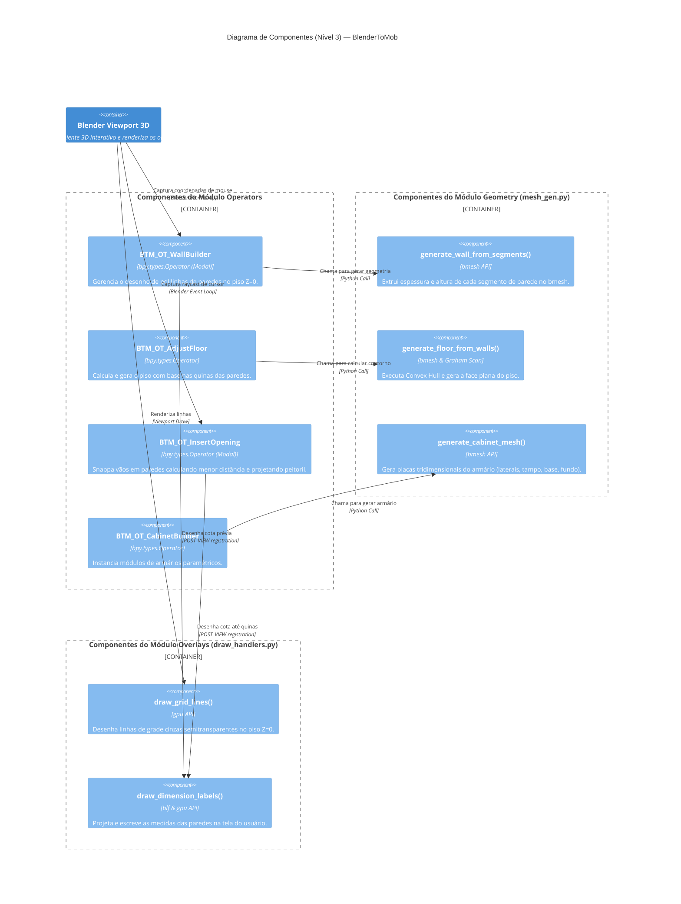
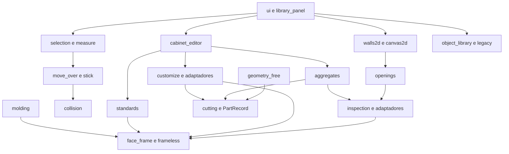

## Re-extração 2026-10-10 — arquitetura atual

🟢 Agrupamento dos componentes no processo Blender. Relações são consumo/orquestração; o mapa detalhado de imports está na matriz de impacto.

Há dependências bidirecionais e imports locais, principalmente seleção/agregados, personalização/editor e grudar/colisão. O desenho por camadas é visão funcional, não prova de grafo acíclico.
