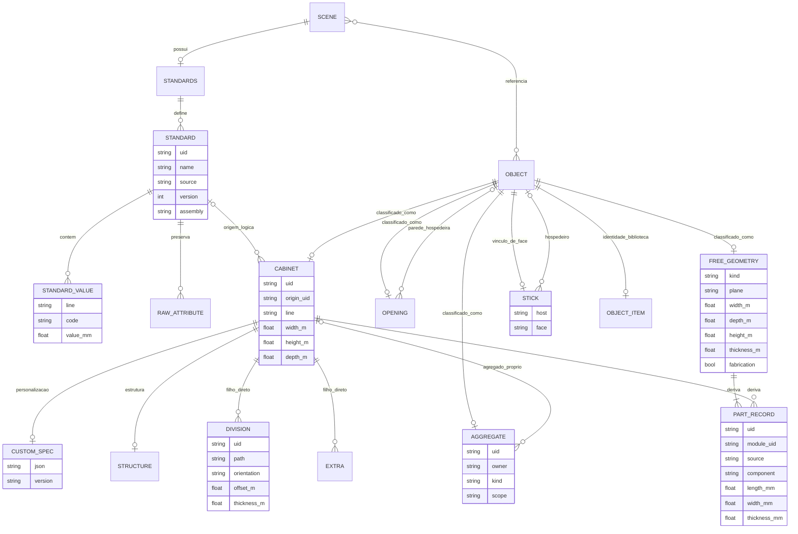

# Modelo Físico Completo (ERD) — BlenderToMob

Este documento apresenta a especificação detalhada de atributos, tipos e relações das entidades persistidas pelo add-on **BlenderToMob**:

```mermaid
erDiagram
    bpy_Scene ||--|| BTM_PG_SceneSettings : has
    bpy_Object ||--|| BTM_PG_WallSegment : extends
    bpy_Object ||--|| BTM_PG_InsertionPlane : extends
    bpy_Object ||--|| BTM_PG_OpeningProperties : extends
    bpy_Object ||--|| BTM_PG_CabinetProperties : extends
    
    BTM_PG_WallSegment {
        float length "Comprimento em mm (default: 2000.0)"
        float absolute_angle "Ângulo absoluto (default: 0.0)"
        float relative_angle "Ângulo relativo (default: 0.0)"
        float thickness "Espessura em mm (default: 150.0)"
        float height_start "Altura inicial em mm (default: 2700.0)"
        float height_end "Altura final em mm (default: 2700.0)"
        float offset "Elevação em mm (default: 0.0)"
        float sagitta "Arco flecha em mm (default: 0.0)"
        float linear_increment "Passo linear do mouse (default: 50.0)"
        float angular_increment "Passo angular do mouse (default: 5.0)"
        string orientation "Sentido ('RIGHT' / 'LEFT')"
        string wall_type "Material ('NORMAL' / 'DRYWALL' / 'GLASS')"
        bool use_as_default "Salvar padrão"
    }

    BTM_PG_InsertionPlane {
        string object_kind "Tipo ('WALL' / 'FLOOR' / 'MODULE' / 'GEOMETRY' / 'OPENING')"
        Pointer parent_plane "Hospedeiro (Object)"
        string layer_id "Camada (default: 'Default')"
        string collision_override "Colisão ('INHERIT' / 'ON' / 'OFF')"
    }

    BTM_PG_OpeningProperties {
        string opening_type "Tipo ('DOOR' / 'WINDOW')"
        float width "Largura em mm (default: 800.0)"
        float height "Altura em mm (default: 2100.0)"
        float sill_height "Peitoril em mm (default: 0.0)"
        Pointer parent_wall "Parede hospedeira (Object)"
    }

    BTM_PG_CabinetProperties {
        float width "Largura em mm (default: 800.0)"
        float height "Altura em mm (default: 700.0)"
        float depth "Profundidade em mm (default: 550.0)"
        float thickness "Espessura chapas em mm (default: 18.0)"
        string cabinet_type "Tipo ('BASE' / 'WALL' / 'TALL')"
    }

    BTM_PG_SceneSettings {
        bool snap_grid "Snap geral (default: True)"
        float snap_increment "Grade snap em mm (default: 50.0)"
        bool collision_global "Colisões físicas (default: True)"
        bool show_grid "Grade visual (default: True)"
        float grid_spacing_x "Espaçamento H em mm (default: 500.0)"
        float grid_spacing_y "Espaçamento V em mm (default: 500.0)"
        bool grid_snap_enabled "Atração ao grid (default: True)"
        float grid_snap_gap "Atração gap em mm (default: 50.0)"
        bool show_insertion_plane "Realce amarelo (default: True)"
        bool show_dimensions "Cotagem visual (default: True)"
    }
```

## Re-extração 2026-10-10 — arquitetura atual

🟢 Modelo lógico atual; não existe esquema de banco SQL. Cardinalidades mostram associação de domínio: propriedade registrada em Object pode existir também em objeto não classificado; herança de coleções Blender permite várias cenas/coleções para um objeto. Não tratar relação Scene/Object como ownership exclusivo.

Atributos no desenho são nomes conceituais simplificados; campos RNA exatos, defaults e armazenamento constam em `data-dictionary.md` e no catálogo abaixo. UID/owner/host são vínculos lógicos; não têm integridade referencial de banco. PartRecord e entidades de sessão não persistem como tabela. Biblioteca de módulos, objetos e categorias usa esquemas independentes; não fundir seus IDs.

### Catálogo completo das estruturas extraídas dos módulos novos

O catálogo inclui DTOs, PropertyGroups, enums de operadores e sessões; inclusão não implica persistência. `modules.json` conserva assinaturas/declaracões AST e caminhos/linhas para campos anotados.

| Módulo | Estrutura | Campos principais ou definição | Fonte |
|---|---|---|---|
| canvas2d | View2D | rect, scale, center | `caffmob_draw/canvas2d` |
| canvas2d | draw.COLORS | <nome> | `caffmob_draw/canvas2d` |
| walls2d | Segment | thickness, height, end_height, wall_type, lock_angle, source | `caffmob_draw/walls2d` |
| walls2d | Chain | nodes, segments, closed, side | `caffmob_draw/walls2d` |
| walls2d | WallPlan | chains, removed_sources, converted_sources, references | `caffmob_draw/walls2d` |
| walls2d | Session | plan, view, selected, drawing, typed, prompt, history, zoom_window | `caffmob_draw/walls2d` |
| walls2d | BTM_PG_WallEditorState | tool, grid_size, new_thickness, new_height, campos virtuais do trecho | `caffmob_draw/walls2d` |
| move_over | Target | kind, value | `caffmob_draw/move_over` |
| move_over | MoveOver (sessão em memória) | a, b, b_is_wall, b_frame / b_frame_inv, box_b / a_local_box, origin_in_b, delta, rotation, original_parent / original_matrix / original_parent_inverse | `caffmob_draw/move_over` |
| move_over | BTM_PG_MoveOverState (WindowManager.btm_move_over) | enabled, tolerance_px, step, show_relative | `caffmob_draw/move_over` |
| move_over | BTM_PG_SavedPosition (Scene.btm_saved_positions, salvo no .blend) | name, delta, rotation, b_side | `caffmob_draw/move_over` |
| move_over | BTM_PG_InsertionPlane (WindowManager.btm_insertion_plane) | active, matrix, source_name | `caffmob_draw/move_over` |
| measure | Placement | x0, width, z0, height, back_y | `caffmob_draw/measure` |
| measure | Cotas | afastamento, anterior, posterior, inferior, superior | `caffmob_draw/measure` |
| measure | ModuleCotas (em memória) | root, wall, on_wall, placement, wall_length, ceiling, depth | `caffmob_draw/measure` |
| selection | Classified | kind, obj, root, library | `caffmob_draw/selection` |
| selection | DeletePlan | remove, openings | `caffmob_draw/selection` |
| selection | Element | obj, info, label | `caffmob_draw/selection` |
| selection | Scene.btm_component_select | value | `caffmob_draw/selection` |
| selection | WindowManager.btm_component_exempt | value | `caffmob_draw/selection` |
| openings | Part | role, name, shape, center, size, material, bevel, leaf, horizontal | `caffmob_draw/openings` |
| openings | Fit | ok, x, width, height, sill, reason | `caffmob_draw/openings` |
| openings | BTM_PG_Opening (Object.btm_opening_real, salvo) | kind, signature, model_version, assembly | `caffmob_draw/openings` |
| openings | BTM_PG_WallRegion (WindowManager.btm_wall_region, sessão) | active, wall, x0, x1, z0, z1, side | `caffmob_draw/openings` |
| aggregates | BTM_PG_Aggregate (Object.btm_aggregate) | is_aggregate, kind, parent_ref, face, u, v, offset, perforate, real_hole, production_part, cutter, orig_parent, pivot, orig_matrix, size, rest_offset, motion, hinge, swing_sign, max_angle, slide_dir, travel, open_value, contact_name, contact_kind, free_travel, rest_overlap | `caffmob_draw/aggregates` |
| aggregates | BTM_PG_Group (Object.btm_group) | is_group, kind, members[] | `caffmob_draw/aggregates` |
| aggregates | BTM_PG_WindowInstall (Object.btm_window) | frame, frame_matrix | `caffmob_draw/aggregates` |
| aggregates | BTM_PG_AssembleRow | label, names, count, role | `caffmob_draw/aggregates` |
| aggregates | MeshPlan / GroupPlan (skp_core) | MeshPlan, GroupPlan | `caffmob_draw/aggregates` |
| collision | OBB (obb.py, frozen) | center, axes, half | `caffmob_draw/collision` |
| collision | Item (rules.py) | name, box, kind, root, linked, override | `caffmob_draw/collision` |
| collision | Conflict (rules.py, frozen) | kind, name_a, name_b, depth, push, location | `caffmob_draw/collision` |
| collision | BTM_PG_Collision (linha) | kind, name_a, name_b, depth, push, location | `caffmob_draw/collision` |
| collision | BTM_PG_CollisionState (WindowManager.btm_collision, não salvo) | items, index, checked, scope, stale, error, checked_names | `caffmob_draw/collision` |
| stick | BTM_PG_Stick (Object.btm_stick, salvo) | is_stuck, host, face_kind, face, plane, u, v, distance, spin, applied_spin, out_of_face, orig_parent, last_world | `caffmob_draw/stick` |
| stick | frame (o, U, V, N) / footprint / params (frame.py, puro) | origem, U, V, N, footprint, params | `caffmob_draw/stick` |
| stick | Preferências do ímã (BTM_AddonPreferences) | stick_magnet, stick_magnet_distance | `caffmob_draw/stick` |
| stick | Scene.btm_settings.stick_migrated | stick_migrated | `caffmob_draw/stick` |
| stick | Estado em memória (apply/settle/magnet_preview) | _index, _last_box, _pending, _quiet_until, _settled, _last | `caffmob_draw/stick` |
| customize | BTM_PG_CustomSpec (Object.btm_custom, salvo) | door_style, drawer_style, pull_model, front_material, material, slide_kind, interior, pull_position, pull_all_fronts, group_materials | `caffmob_draw/customize` |
| customize | Spec / Opening / Interior (spec.py, puros) | Spec.library, Spec.openings, Spec.part_materials, group_materials, Spec.pull_all_fronts, Spec.aggregates, Opening.path, Opening.front, Opening.drawer_count, Opening.interior, Interior.shelves, dividers, drawers, Interior.heights | `caffmob_draw/customize` |
| customize | Manifesto caffmob_draw.user-module 1.1.0 (<nome>.json) | format, schema_version, name, category, library, root_object, created, addon_version, dimensions_mm, styles.door_styles, materials, pulls, spec, structure, divisions | `caffmob_draw/customize` |
| customize | Entrada da biblioteca (list_modules) | name, category, blend, png, json, has_manifest | `caffmob_draw/customize` |
| cabinet_editor | BTM_PG_Structure (Object.btm_structure, na raiz, salvo) | components, back_mode, back_setback, auto_back, extras | `caffmob_draw/cabinet_editor` |
| cabinet_editor | BTM_PG_Division (Object.btm_division, na chapa de divisão, salvo) | is_division, uid, space, orientation, offset, use_front, front, use_back, back, thickness, material, bay, kind, follow | `caffmob_draw/cabinet_editor` |
| cabinet_editor | BTM_PG_Extra (Object.btm_extra, nas peças da 008, salvo) | is_extra, kind, catalog_id, space, slot, params | `caffmob_draw/cabinet_editor` |
| cabinet_editor | EditorState / Draft (state.py, puros) | dimensions, spec, structure, divisions, extras, slides, interiors, backs, Draft.initial, current, history | `caffmob_draw/cabinet_editor` |
| cabinet_editor | Message (validate.py) | code, severity, component, parameter, value, range, action | `caffmob_draw/cabinet_editor` |
| cabinet_editor | Part, Box, Division, RoleState, Item, Piece, Leaf/Track/Layout (puros) | Part, Item | `caffmob_draw/cabinet_editor` |
| cabinet_editor | Session + WindowManager.btm_cabinet_editor (em memória) | Session.requests, Session.request, width/height/depth, tree_*, value_*, comp_*, bays, pos_*, space, tab | `caffmob_draw/cabinet_editor` |
| standards | PromobDocument | name, version, is_system, changed, attributes | `caffmob_draw/standards/io_promob.py` |
| standards | BTM_PG_StandardValue | value, text, is_text | `caffmob_draw/standards/model.py` |
| standards | BTM_PG_RawAttribute | attr_id, value, key | `caffmob_draw/standards/model.py` |
| standards | BTM_PG_StandardDefinition | uid, builtin, market, source, version, updated_at, values, raw_attributes, assembly | `caffmob_draw/standards/model.py` |
| standards | BTM_PG_Standards | definitions, active_index, schema_version | `caffmob_draw/standards/model.py` |
| standards | BTM_PG_StandardTreeItem | label, node_type, key, depth, path | `caffmob_draw/standards/model.py` |
| standards | BTM_PG_StandardsDraft | definition_uid, definition_name, values, tree, tree_index, expanded, search, selected_key, edit_text, edit_enum, error, assembly, include_manual | `caffmob_draw/standards/model.py` |
| standards | Component | code, label_pt, label_en, tree, thickness_class, promob, promob_fit, visible_sides_br | `caffmob_draw/data/dimension_schema.py` |
| standards | Param | key, line, group, label_pt, label_en, unit, type, default_br, default_us, min, max, step, precision, enum_items, zero_meaning, negative_allowed, image_key, promob_codes, legacy_targets, component, field, description_pt | `caffmob_draw/data/dimension_schema.py` |
| standards | ModuleInfo | name, kind, standard_uid, own | `caffmob_draw/standards/apply_core.py` |
| standards | Plan | follow, differ, not_applicable, legacy | `caffmob_draw/standards/apply_core.py` |
| standards | Defaults | width, height, depth, z, thickness, carcass, warning | `caffmob_draw/standards/cabinet_defaults.py` |
| legacy | LegacyOpening | LegacyOpening = namedtuple('LegacyOpening', 'front drawer_count shelves', defaults=(0, 0)) | `caffmob_draw/legacy/convert_core.py` |
| legacy | Loss | Loss = namedtuple('Loss', 'key count') | `caffmob_draw/legacy/convert_core.py` |
| legacy | LegacyCabinet | library, cabinet_type, width, height, depth, line, openings, shelves, other_fronts | `caffmob_draw/legacy/convert_core.py` |
| legacy | Result | Result = namedtuple('Result', 'legacy_name library module_name losses') | `caffmob_draw/legacy/convert.py` |
| legacy | Reading | Reading = namedtuple('Reading', 'name library cabinet box world parent collection aggregates') | `caffmob_draw/legacy/convert.py` |
| legacy | BTM_OT_LegacyConvert | only_active | `caffmob_draw/legacy/ops.py` |
| library_panel | BTM_PG_LibraryState | open, category, line | `caffmob_draw/library_panel/props.py` |
| library_panel | Category | Category = namedtuple('Category', 'name line fixed') | `caffmob_draw/library_panel/categories_core.py` |
| library_panel | Model | Model = namedtuple('Model', 'id label cabinet_type width_mm door_swing shelves') | `caffmob_draw/library_panel/models_core.py` |
| library_panel | Layout | Layout = namedtuple('Layout', 'label items') | `caffmob_draw/library_panel/layout_core.py` |
| library_panel | BTM_OT_LibraryInsertModel | model_id, line | `caffmob_draw/library_panel/popover.py` |
| library_panel | BTM_OT_LibraryCategoryCreate | name, line | `caffmob_draw/library_panel/ops_categories.py` |
| library_panel | BTM_OT_LibraryCategorySetLine | category, line | `caffmob_draw/library_panel/ops_categories.py` |
| library_panel | BTM_OT_LibraryCreateCabinet | cabinet_type, width, assembly, line, open_editor | `caffmob_draw/library_panel/ops_cabinet.py` |
| object_library | Entry | item_id, name, category, root, source, author, license, size_mm, features, materials, created_at, addon_version | `caffmob_draw/object_library/catalog.py` |
| object_library | Item | entry, user, blend, manifest, thumb | `caffmob_draw/object_library/store.py` |
| object_library | BTM_PG_ObjectItem | is_item, item_id, category, source, license | `caffmob_draw/object_library/props.py` |
| object_library | BTM_PG_ObjectLibraryUI | category, search | `caffmob_draw/object_library/props.py` |
| object_library | BTM_OT_ObjectInsert | key | `caffmob_draw/object_library/ops.py` |
| object_library | BTM_OT_ObjectLibraryRemove | key | `caffmob_draw/object_library/ops.py` |
| object_library | BTM_OT_ObjectLibraryAdd | name, category, source, license_text, author, filepath, duplicate | `caffmob_draw/object_library/ops.py` |
| object_library | BTM_OT_ObjectRetextureFinish | finish, scope | `caffmob_draw/object_library/ops.py` |
| object_library | BTM_OT_ObjectRetextureImage | filter_glob, size_mm, scope | `caffmob_draw/object_library/ops.py` |
| inspection | Leaf | Leaf = namedtuple('Leaf', 'side hinge_x hinge_y dx dy length thickness height rot_sign') | `caffmob_draw/inspection/room_door_math.py` |
| inspection | BTM_PG_Interference | front_name, module_name, hit_name, location, kind | `caffmob_draw/inspection/props.py` |
| inspection | BTM_PG_InspectionState | active, snap_stops, default_angle, interferences, interference_index, checked_fronts | `caffmob_draw/inspection/props.py` |
| inspection | BTM_OT_FrontsSetOpen | scope, mode | `caffmob_draw/inspection/ops_inspect.py` |
| inspection | BTM_OT_CheckFrontInterference | scope | `caffmob_draw/inspection/ops_interference.py` |
| inspection | BTM_OT_InterferenceGoto | index | `caffmob_draw/inspection/ops_interference.py` |
| molding | FACTS | role, corner, kick, crown_mount, finished_left, finished_right | `caffmob_draw/molding/adapters.py` |
| molding | ProfileStackEntry | profile_ref, fallback_key, dx, dy | `caffmob_draw/molding/packages.py` |
| molding | MoldingSweep | IS_HB_MOLDING_SWEEP, HB_MOLDING_TYPE, HB_MOLDING_MEMBERS | `caffmob_draw/molding/ops.py` |
| geometry_free | BTM_OT_GeometryCreate | kind | `caffmob_draw/geometry_free/ops_create.py` |
| geometry_free | BTM_PG_GeometryProps | kind, plane, width, depth, height, thickness, fabrication, component, material, finish | `caffmob_draw/geometry_free/props.py` |
