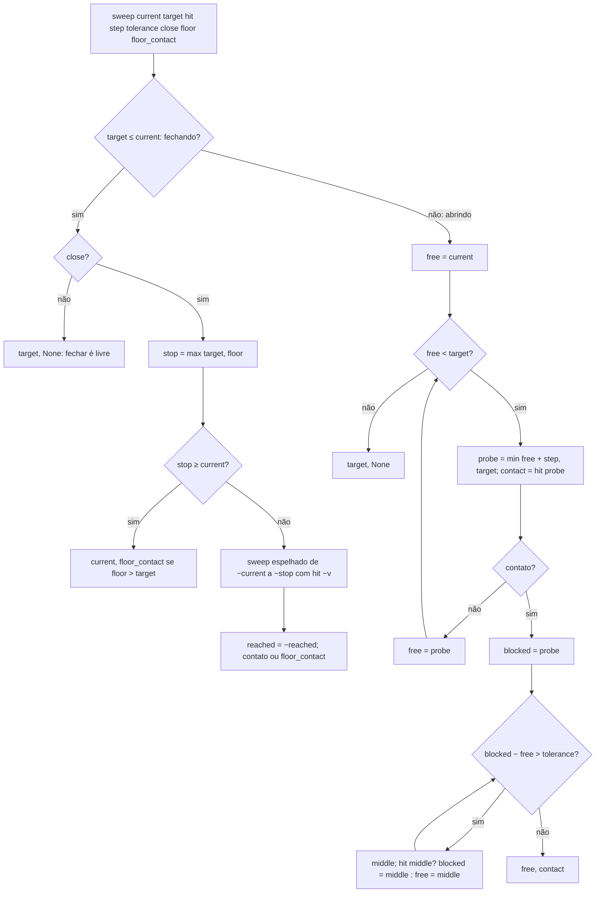
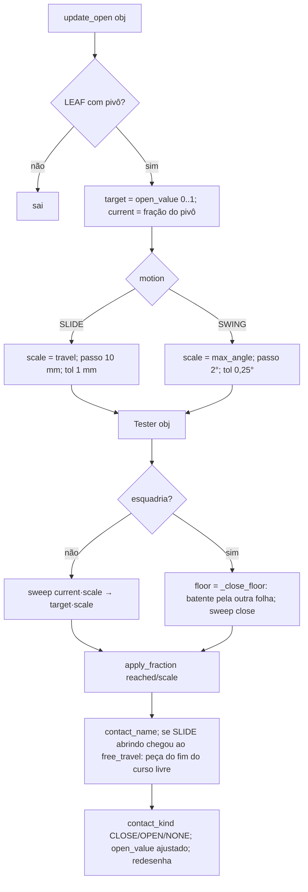
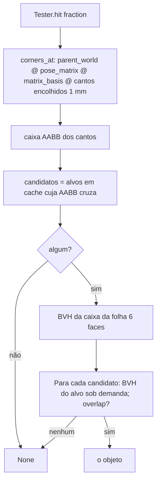

# Fluxograma: `sweep.sweep`, `leaf.update_open` e `collision.Tester.hit` (aggregates)

Abrir e fechar a folha parando no primeiro contato (RN-11a; esquadria D-10).

Alvos excluídos: a folha, o pivô e descendentes; na esquadria as folhas irmãs e o pai (as peças da esquadria contam);
fora dela a raiz do módulo do pai; arame, bounds, cortadores, anotações, invisíveis, e as peças com `btm_opening_frame`
igual ao pai (marco da porta real).
