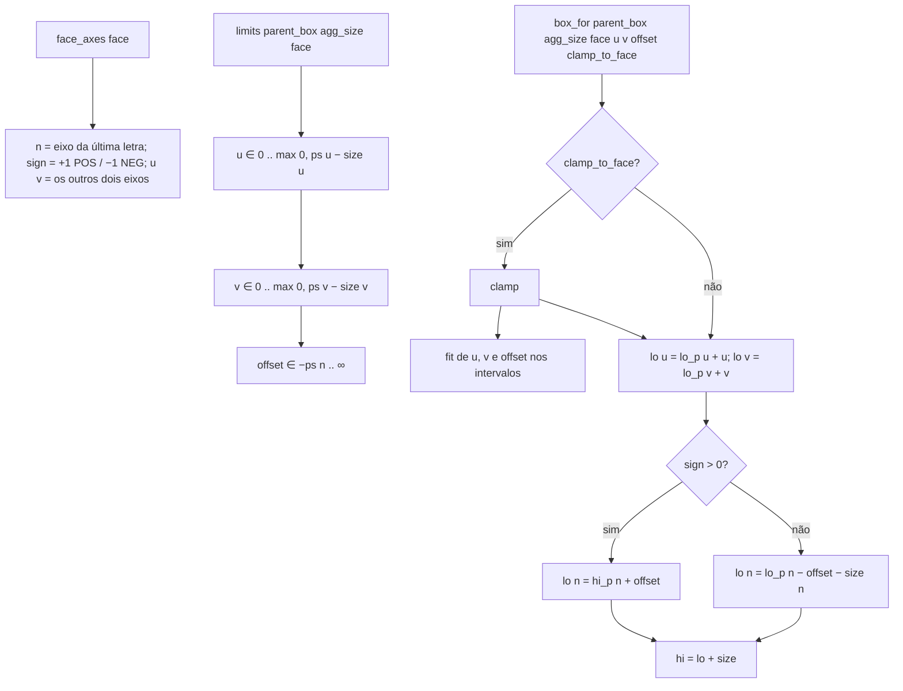
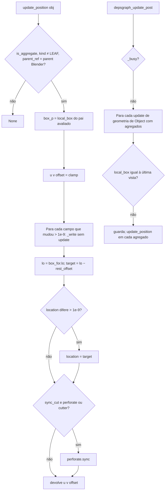

# Fluxograma: `limits.clamp`, `box_for` e `apply.update_position` (aggregates)

Agregado preso a uma face do pai (RN-08, RN-09).

`sunk_box` = interseção entre a caixa do pai e a do agregado (None se não afunda); `sunk_depth` mede no eixo da face.
O ramo `clamp_to_face=False` não tem chamador: a docstring de `box_for` diz que o grudar (feature 004) o usa, mas `stick/` não chama `box_for` (só `FACES`, `FACE_LABELS`, `face_axes`, `thickness`) _(Revisão cruzada 2026-10-10: único chamador é aggregates/apply.py:61)_.
