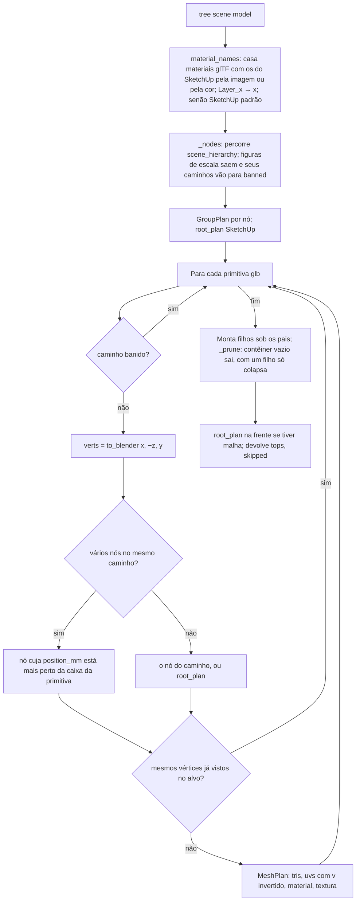

# Fluxograma: `skp_core.tree` e `skp_build.build` (aggregates)

Do SketchUp (OpenSKP) à árvore de grupos de peças no Blender (features 009 e 010).



```mermaid
flowchart TD
    A[build context model scene] --> B[tree; pasta temporária; caches de imagens e materiais]
    B --> C[_build_node em cada topo]
    C --> D[Filhos primeiro, recursivo]
    D --> E[Para cada MeshPlan: material por assinatura nome|cor|imagem, reaproveitado se já existe]
    E --> F{textura?}
    F -- sim --> G[grava imagem na pasta; load; pack; nó Image Texture → Base Color]
    F -- não --> H
    G --> H[Mesh from_pydata + UV + material; Object na coleção]
    H --> I{malhas?}
    I -- sim --> J[group.create_group PLAIN com o nome da instância]
    I -- não --> K[Empty contêiner com btm_group no centro dos filhos]
    J --> L[Filhos parentados ao grupo mantendo o mundo]
    K --> L
    L --> M[grupos de topo, figuras puladas]
```

`skp.read` levanta `ValueError` com o motivo quando a wheel do OpenSKP falta, o arquivo não existe, não abre ou não tem
geometria; `ops_import._import_skp` apaga o que criou se a montagem falhar.
