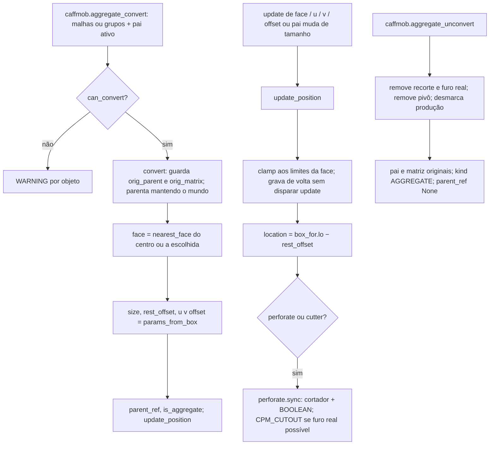
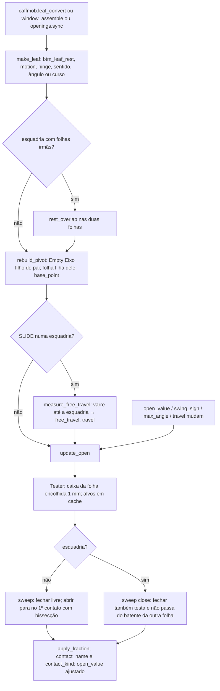
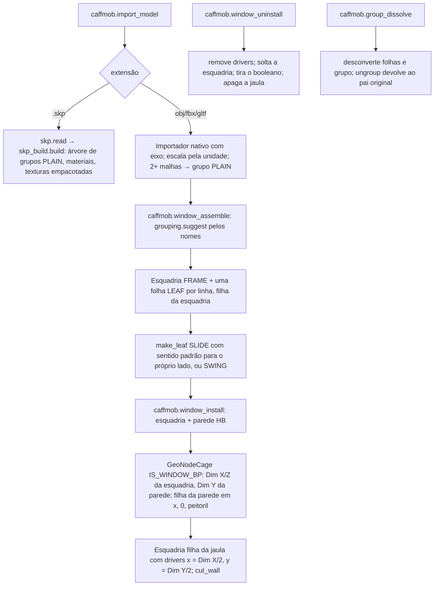
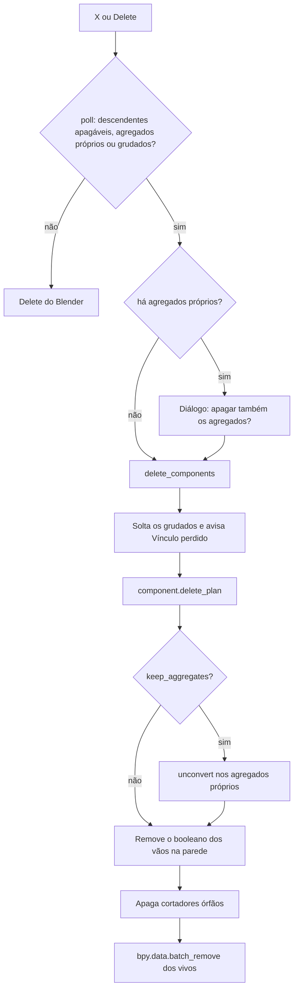

# Fluxograma do Módulo: aggregates

Agregados, folhas, grupos, esquadria e SketchUp (`caffmob_draw/aggregates/`), nível **Detalhado**. Re-extração
2026-10 (Fase 2c).

## 1. Converter, posicionar e desconverter

## 2. Folha de porta

## 3. Grupos, esquadria e janela na parede

## 4. Apagar com agregados (X / Delete)

