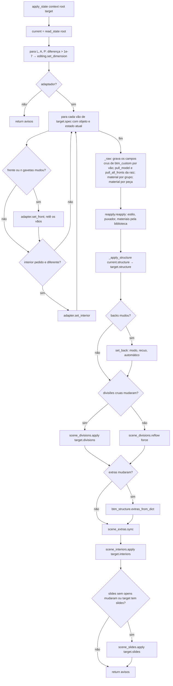
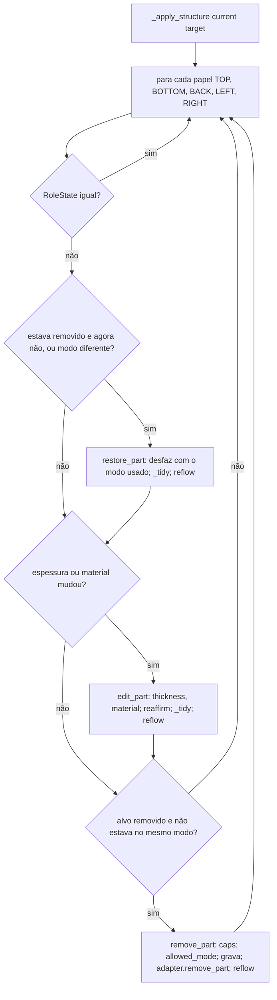
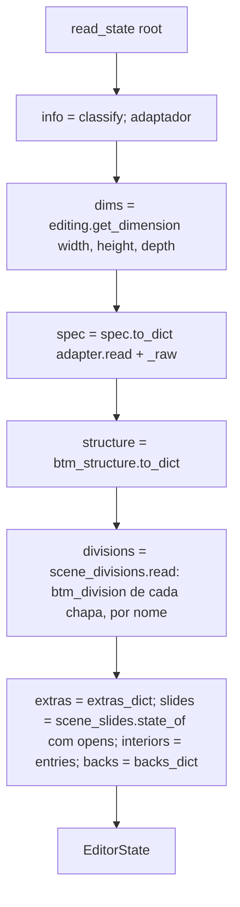

# Fluxograma: `bridge.read_state`, `apply_state` e `_apply_structure` (cabinet_editor)

Levar o módulo a um instantâneo do rascunho (desfazer/refazer, Cancelar, janela fechada). Muda só o que difere.

A ordem dentro de `_apply_structure` segue a regra da 006: o registro em `btm_structure` muda antes de chamar o
adaptador, porque o recálculo das bibliotecas reafirma o que está gravado. A montagem (012) não está no instantâneo
(ver code-analysis §14.16).
