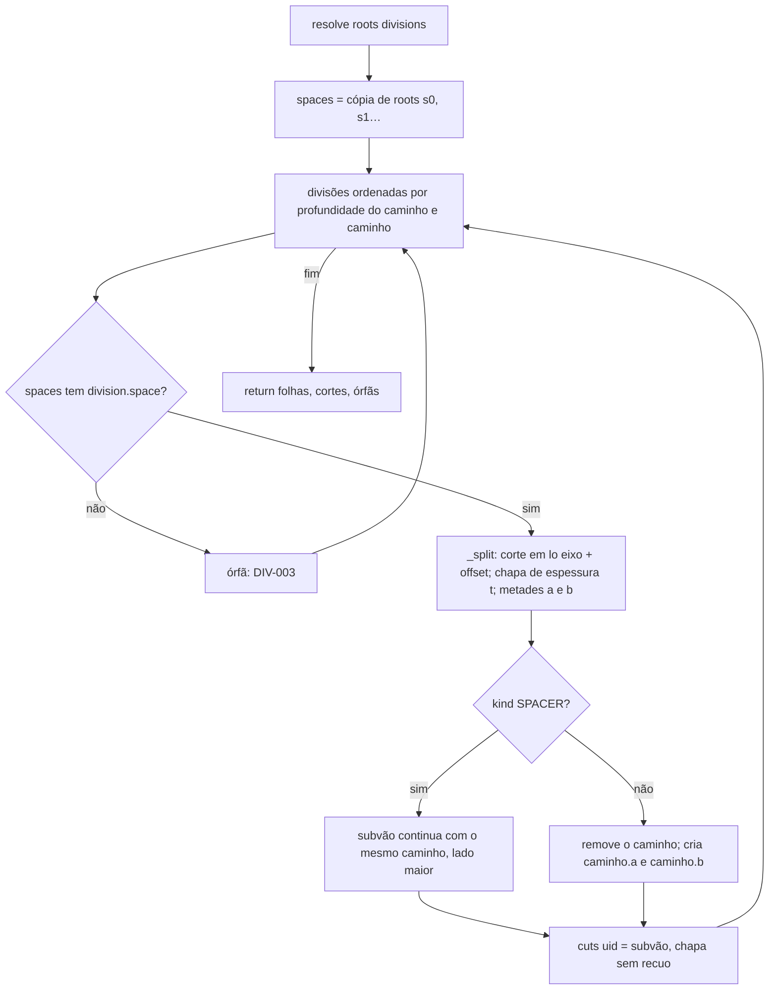
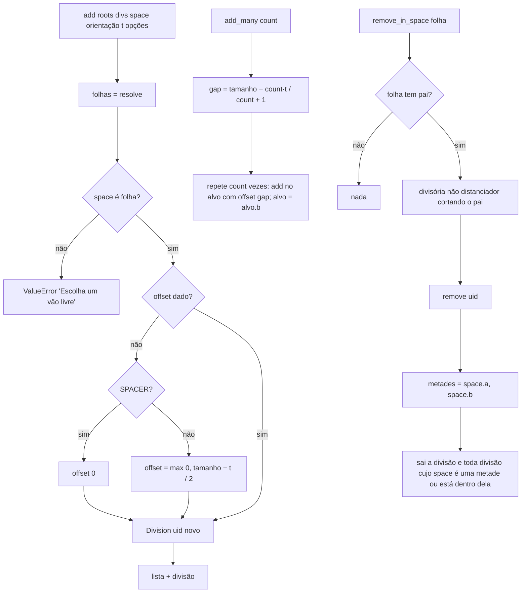
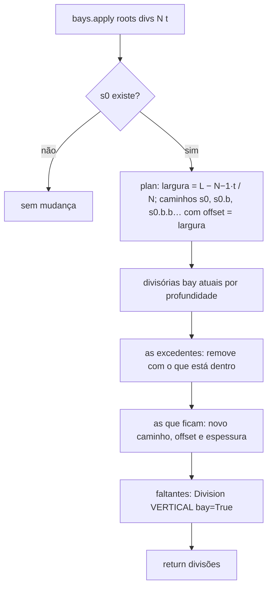

# Fluxograma: `divisions.resolve`, `add`, `add_many`, `remove` e `bays.apply` (cabinet_editor)

Subvãos do armário (feature 006, D‑04, D‑05; 008, D‑10, D‑15, D‑22). Puro, no referencial da raiz.

`validate` aplica `offset_range` (mínimo 50 mm de cada lado; distanciador pode encostar) e a profundidade mínima de
50 mm depois dos recuos (`place`). O `offset` é medido a partir da face esquerda/de baixo do subvão, então quando o
vão‑raiz muda de tamanho a chapa mantém a distância e o resto se ajusta (RN‑16).
