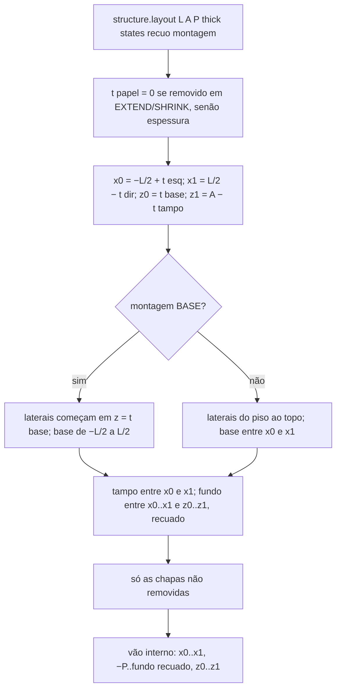
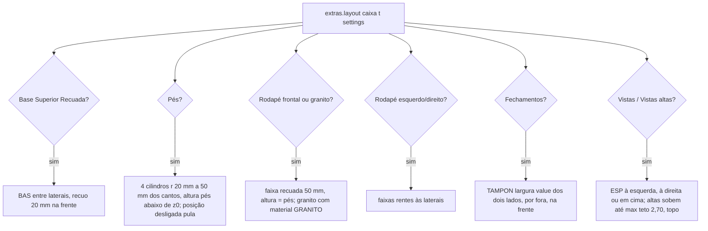
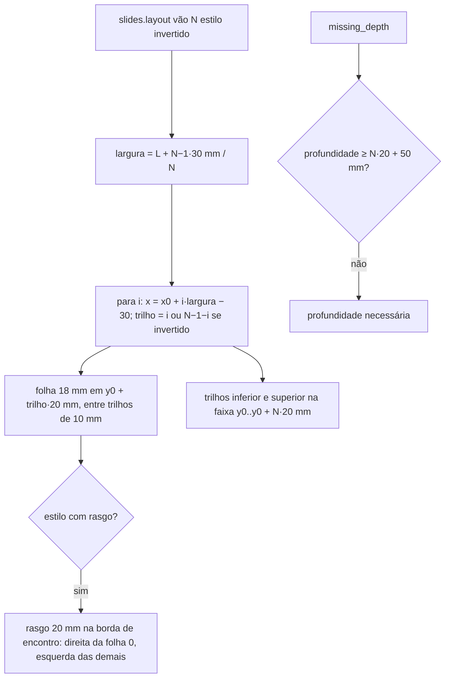
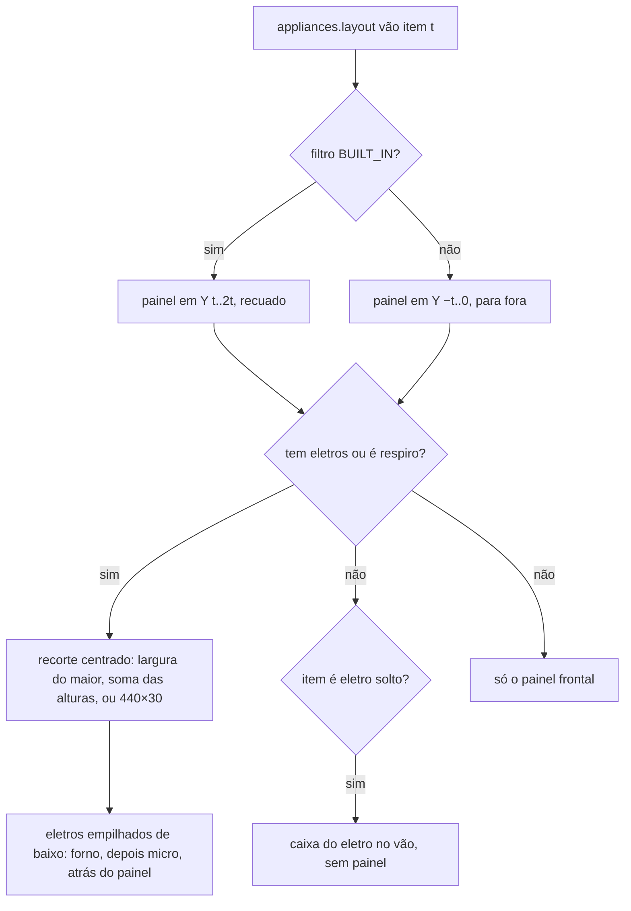

# Fluxograma: `structure.layout`, `extras.layout`, `slides.layout` e `appliances.layout` (cabinet_editor)

Geometria das chapas e peças geradas pelo editor (features 006, 008 e 012). Puro; caixas `(lo, hi)` no referencial da
raiz (X largura, Y profundidade com a frente no menor Y, Z altura).

Na cena, `scene_parts.place` põe a espessura no eixo mais fino da caixa (Z sem rotação, X com −90° em Y, Y com +90°
em X, os dois últimos com `Mirror Z`). O painel p/ eletro ganha um modificador `CPM_CUTOUT` com o recorte, que o plano
de corte leva para a usinagem.
