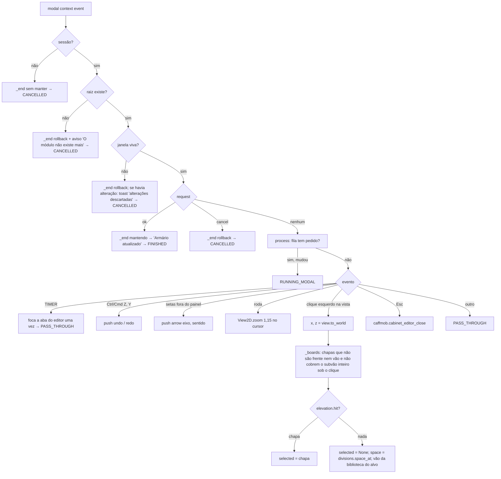
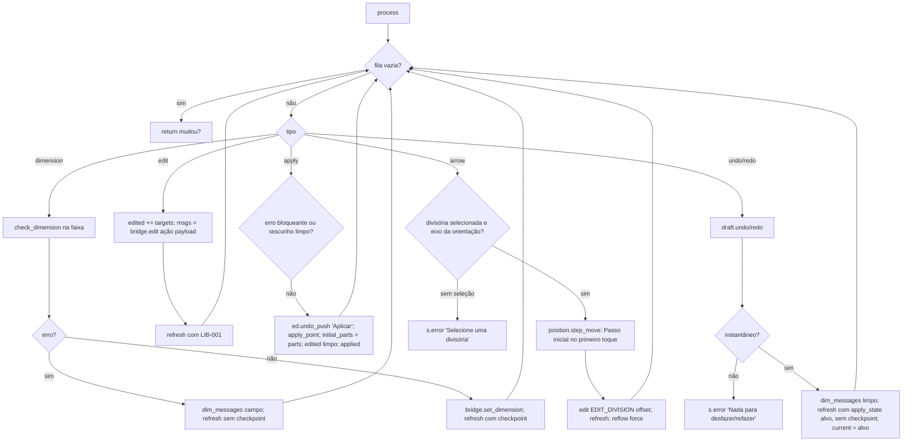
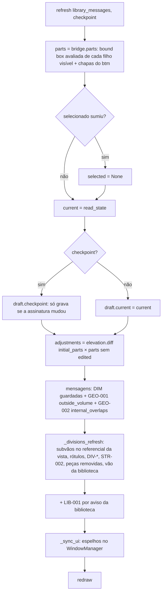

# Fluxograma: `BTM_OT_CabinetEditorModal.modal`, `process` e `refresh` (cabinet_editor)

Ciclo do editor (D‑21, D‑22, D‑04, D‑06, D‑16): o modal é o único que muda a cena; o rascunho guarda instantâneos.

Por que a fila: um botão com `UNDO` criaria um passo de desfazer por clique; dentro do modal, o Blender só registra
o passo quando o modal termina com `FINISHED` (OK). Aplicar empurra um passo explícito (`ed.undo_push`) sem fechar.
