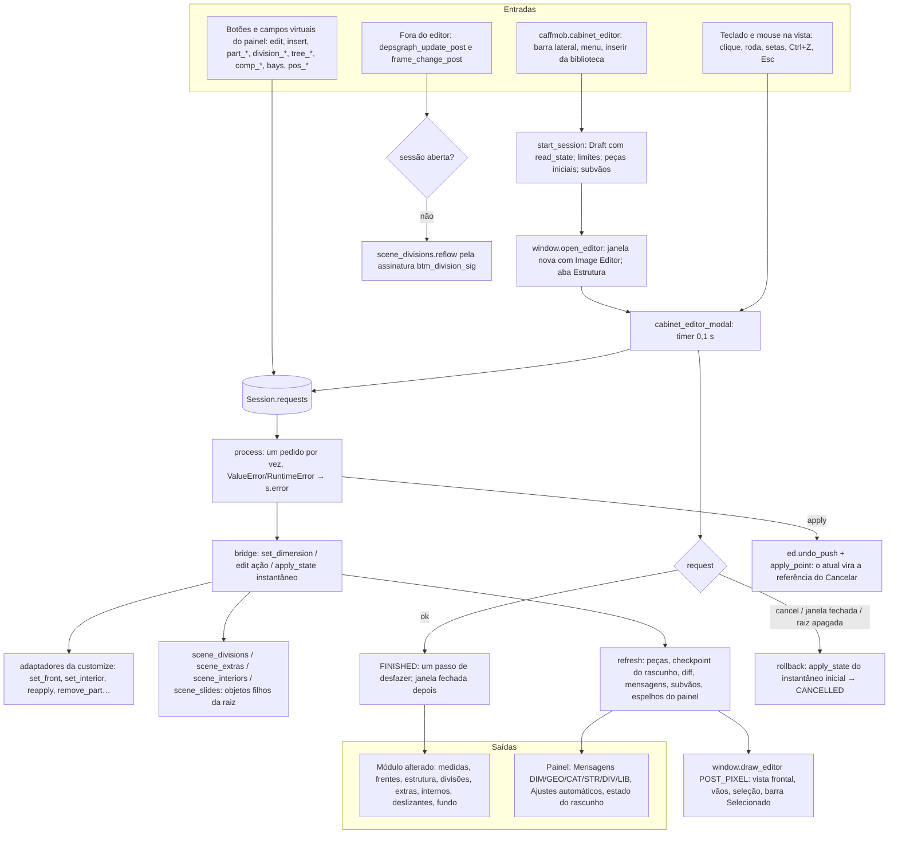

# Fluxograma: módulo `cabinet_editor`

Editor de Armário em janela própria (feature 004), com as abas da 006 e o Construtor da 008 (7 abas), mais a montagem
da 012. Os botões só enfileiram pedidos; um único modal com `UNDO` muda a cena (D‑21, D‑22).

Núcleos puros sem `bpy` (testados fora do Blender): `state`, `validate`, `elevation`, `structure`, `divisions`,
`catalog`, `extras`, `bays`, `slides`, `appliances`, `position`. Fluxogramas por função:
[`cabinet_editor-modal_process.md`](cabinet_editor-modal_process.md),
[`cabinet_editor-apply_state.md`](cabinet_editor-apply_state.md),
[`cabinet_editor-divisions_resolve.md`](cabinet_editor-divisions_resolve.md),
[`cabinet_editor-layouts.md`](cabinet_editor-layouts.md).
