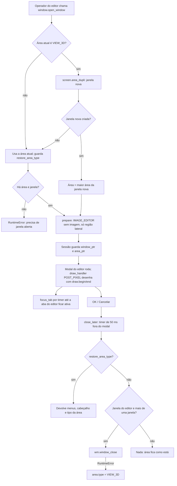
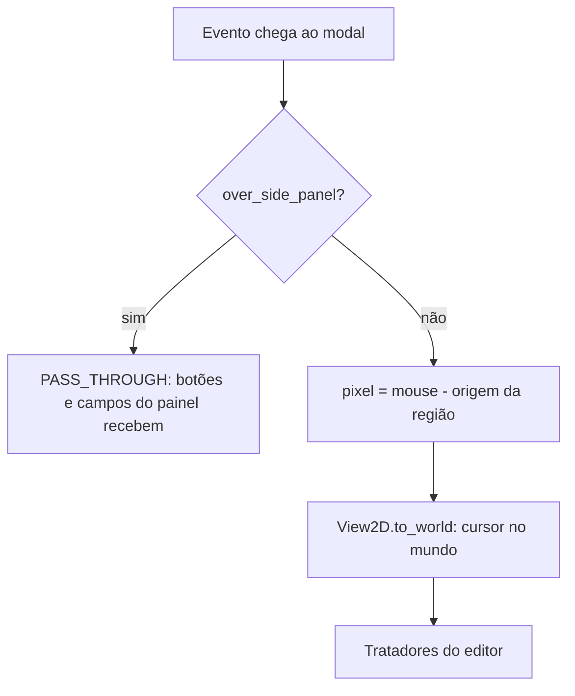
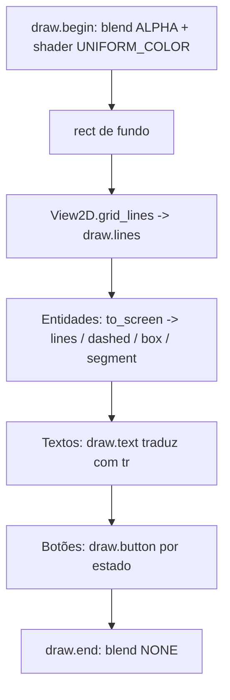

# Fluxograma do Módulo: canvas2d

Fluxo das telas 2D próprias do add-on (`caffmob_draw/canvas2d/`), no nível de documentação **Detalhado**. Re-extração
2026-10 (Fase 2c).

---

## 1. Ciclo de vida de uma tela 2D

_(Revisão cruzada 2026-10-10: canvas2d/window.py:_close — `VIEW_3D` só no `except RuntimeError` de `wm.window_close`; com uma janela só ou outra janela, nada é feito)_

## 2. Eventos do mouse e sobreposição de regiões

## 3. Desenho de um quadro

