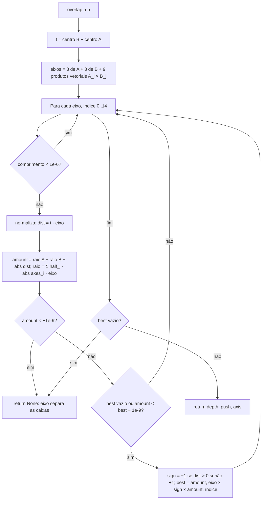
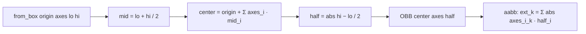

# Fluxograma: `obb.overlap` (collision)

Teste dos eixos separadores (SAT) entre duas caixas orientadas; devolve a menor sobreposição e o empurrão que a desfaz (D-12, D-19).

`push` aponta de B para fora de A pelo eixo de menor sobreposição: é o deslocamento que "Afastar até encostar" aplica
a `name_a`. `axis` 0–2 = face de A, 3–5 = face de B, 6–14 = aresta × aresta.
