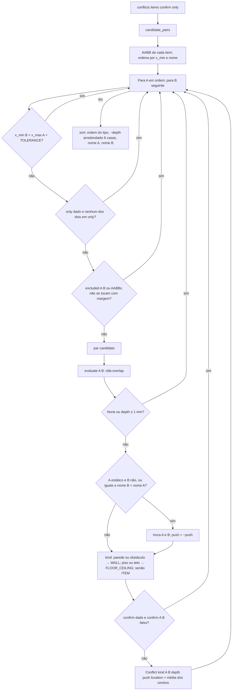
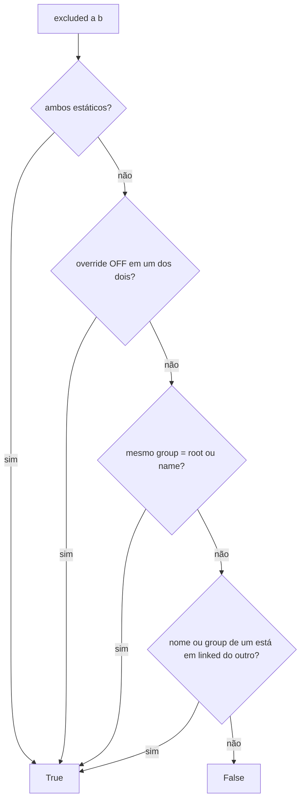

# Fluxograma: `rules.conflicts` (collision)

Pares candidatos, exclusões (RN-12), encostar não é colisão (RN-11) e ordem estável (RN-13).

A varredura em X evita o produto cartesiano: cada A só compara com os B cuja faixa em X ainda alcança a dele. Um par
gera uma única ocorrência; `name_a` é sempre o item que pode ser movido.
