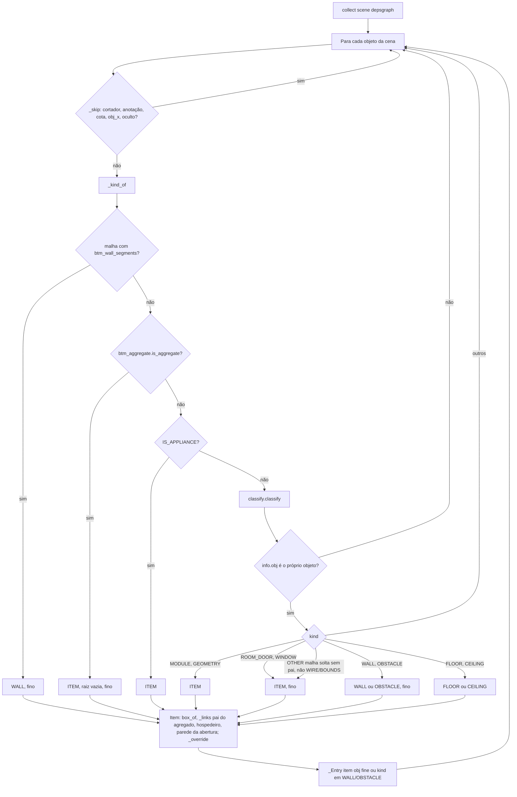
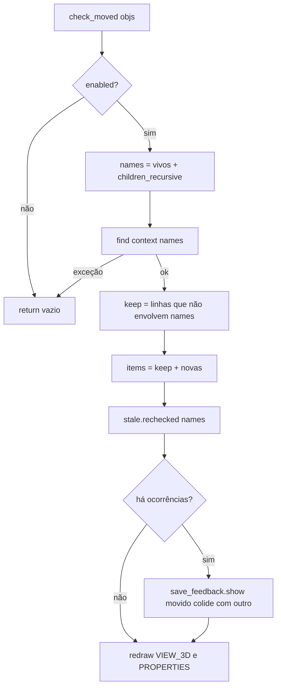
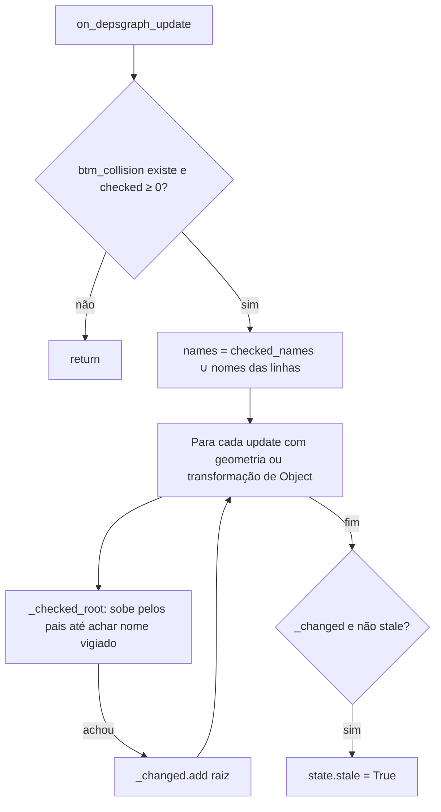

# Fluxograma: `scan.collect`, `scan.check_moved` e `stale.on_depsgraph_update` (collision)

Tradução da cena em itens (D-13), aviso ao soltar (D-16, RF-23) e marcador "desatualizado" (D-15, RN-14).

`_confirm` só consulta a malha quando um dos dois é fino; o BVH do objeto vem de `to_mesh` avaliado no mundo, com recuo
para as seis faces da OBB. `rechecked` tira os movidos de `_changed`: se nada mais mudou, o resultado volta a estar em dia.
